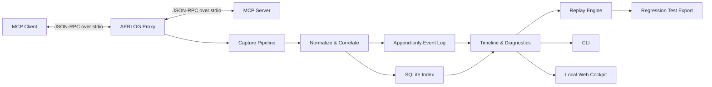

<div align="center">

# AERLOG

### Agent Execution Recorder & Log

**Record. Reconstruct. Replay. Improve.**

A local-first observability, debugging, and reliability toolkit for MCP-powered AI agents.

[](#project-status)
[](https://modelcontextprotocol.io/)
[](https://www.python.org/)
[](#license)

*An execution-level flight recorder for AI agents — capture what happened, understand where it failed, and reproduce the failure without blindly running the same actions again.*

</div>

---

## The Problem

AI agents are not single requests.

A seemingly simple task can involve a sequence of model decisions, MCP tool calls, server responses, retries, timeouts, and state transitions.

When an agent fails, developers often have to reconstruct the execution from scattered terminal output or application logs.

The result is a frustrating debugging loop:

- **What actually happened?** Which tools were called, in what order, and with what observable inputs and outputs?
- **Where did it go wrong?** Was it a timeout, protocol error, malformed response, repeated call, or a failure that was incorrectly treated as success?
- **Can the failure be reproduced?** Can the same interaction be tested again without depending on a live external service?
- **Did a change fix it?** Can a captured failure become a repeatable regression test?

Traditional logs are useful, but they do not necessarily provide a coherent execution timeline. General-purpose LLM observability platforms can provide broader traces and model-level analytics, but developers may still need a focused way to capture and replay protocol interactions between an MCP client and its servers.

## What is AERLOG?

AERLOG is a proposed **local-first MCP execution recorder and reliability workbench**.

It is designed to sit between an MCP client and an MCP server, observe their protocol traffic, and persist a structured record of an execution.

Developers can then:

1. Inspect the execution timeline.
2. Investigate failures.
3. Replay recorded interactions in a controlled environment.
4. Export regression tests from captured failures.

The core idea:

> Turn an opaque agent execution into an inspectable, reproducible, testable artifact.

### Design Goals

| Goal | What it means |
|---|---|
| Protocol transparency | Observe and forward MCP traffic without changing its meaning |
| Execution visibility | Reconstruct requests, responses, notifications, timing, and errors |
| Failure localization | Highlight the earliest observable failure and subsequent recovery behavior |
| Reproducibility | Replay captured interactions without requiring the original live service |
| Safe by default | Never repeat potentially destructive operations automatically |
| Local-first | Keep recordings and indexes on the developer's machine by default |
| Extensible | Preserve unknown protocol data and allow future protocol-aware analysis |

### Non-Goals for the Initial Release

AERLOG is not intended to be:

- A replacement for an MCP client, MCP server, or MCP SDK.
- A model reasoning debugger or a tool for extracting private chain-of-thought.
- A general-purpose LLM analytics platform.
- An autonomous agent that silently fixes code or reruns production actions.
- A distributed observability backend requiring Kubernetes, Kafka, or cloud infrastructure.
- A guarantee that every agent failure can be inferred from protocol traffic alone.

---

## Core Capabilities

The following describes the intended product. Features should be marked as implemented only when they exist and have tests.

### 1. Capture MCP Executions

Run an MCP-capable client/server process through a local stdio proxy. The proxy observes protocol messages while forwarding them between the two sides.

Capture candidates include:

- JSON-RPC requests and responses.
- Notifications and protocol lifecycle messages.
- Tool calls and their observable results.
- Request IDs and message relationships.
- Timestamps, durations, process lifecycle, and transport errors.
- Timeouts, cancellations, malformed messages, and process exits.

AERLOG should preserve original message content where possible and avoid making assumptions about methods it does not understand.

### 2. Reconstruct an Execution Timeline

Convert captured events into a readable execution timeline.

For each execution, developers should be able to inspect:

- Event order and timestamps.
- Request/response correlation.
- Tool name and call arguments, subject to redaction settings.
- Response payloads and protocol errors.
- Duration and timeout information.
- Process and session lifecycle.
- Gaps, missing responses, and suspicious repeated calls.

The timeline is based on **observable protocol events**, not guesses about what the model privately thought.

### 3. Investigate Failures

AERLOG should provide evidence-backed diagnostics rather than pretending to know the agent's hidden intent.

Initial detection rules may include:

| Signal | Possible interpretation |
|---|---|
| Request without a matching response | Timeout, disconnect, or incomplete capture |
| JSON-RPC error response | Explicit protocol or server-side error |
| Server process exits unexpectedly | Server crash or shutdown |
| Repeated equivalent calls | Possible retry loop or lack of progress |
| Repeated timeout pattern | Unavailable or unresponsive dependency |
| Tool error followed by apparent completion | Potential false-success condition requiring inspection |

A diagnostic should include the events that support it, its confidence or severity, and what remains unknown.

### 4. Replay Recorded Interactions

A recording can become a deterministic test fixture.

Planned replay modes:

| Mode | Behavior | Risk |
|---|---|---|
| Inspect | View captured interactions without executing anything | Low |
| Cassette | Return recorded responses to a client or test harness | Low |
| Mocked replay | Run a controlled test against mocked dependencies | Controlled |
| Live replay | Re-contact real MCP servers | High; opt-in only |

**Live replay must never be the default.**

Recorded tool calls may have side effects. A replay engine must not assume that repeating a request is safe merely because it was safe to record.

### 5. Turn Failures into Regression Tests

Developers should be able to export a captured interaction into a portable test fixture containing:

- The relevant request/response sequence.
- Expected protocol behavior.
- Timing or timeout expectations where meaningful.
- Assertions for response shape and error handling.
- Redaction metadata and fixture provenance.

The goal is to make a once-manual debugging session repeatable in CI.

### 6. Developer Cockpit

The initial interface should be a CLI. A lightweight local web UI can follow once the recording and replay foundations are reliable.

The planned cockpit may include:

- Execution list and search.
- Chronological event timeline.
- Request/response detail inspector.
- Failure markers and diagnostic evidence.
- Replay controls and safety warnings.
- Regression fixture export.

---

## How It Works

### High-Level Architecture



The proxy is the observation point. The capture pipeline turns observed traffic into structured events. Storage preserves the evidence. Analysis builds an execution view. Replay and test export consume the stored recording.

### Component Responsibilities

| Component | Responsibility |
|---|---|
| MCP client | The application or agent initiating MCP communication |
| stdio proxy | Launches/communicates with the server and transparently forwards traffic |
| Capture pipeline | Reads protocol messages and records transport/process events |
| Normalizer | Converts observed messages into a consistent internal event representation |
| Correlator | Associates requests and responses using protocol/session identifiers |
| Event store | Persists the append-only event stream |
| Metadata index | Supports execution lookup, filtering, and event navigation |
| Timeline builder | Produces a chronological, correlated execution view |
| Diagnostics engine | Applies deterministic rules to identify suspicious or failed behavior |
| Replay engine | Replays recordings against controlled fixtures or mocks |
| Exporter | Produces portable regression fixtures and tests |
| CLI / cockpit | Developer-facing inspection and control surfaces |

### Capture Flow

1. The developer starts an execution through AERLOG.
2. AERLOG launches or connects to the configured MCP server process.
3. The client communicates through the proxy.
4. The proxy reads each message, records the observable event, and forwards the message.
5. Responses and notifications are captured in the same execution context.
6. Events are normalized, correlated, and persisted.
7. The execution becomes available for inspection.
8. The developer can inspect diagnostics, replay a cassette, or export a regression test.

The proxy should prioritize **correct forwarding** over analysis.

If a message cannot be understood by the current parser, AERLOG should preserve it as an unknown/raw event where safe rather than silently dropping or rewriting it.

---

## System Design

### 1. Transparent Stdio Proxy

The first implementation should focus on the stdio transport because it offers a practical, bounded starting point.

The proxy is responsible for:

- Starting the configured MCP server as a subprocess.
- Managing stdin/stdout pipes and stderr separately.
- Forwarding messages in both directions.
- Recording messages without corrupting framing or ordering.
- Handling process termination, broken pipes, and cancellation.
- Applying backpressure so recording does not cause unbounded memory growth.
- Shutting down child processes cleanly.

**Important:** stdout is protocol traffic for stdio MCP servers. Debug logs must not be written into the protocol stream. AERLOG's own diagnostics should go to stderr or a separate log destination.

The proxy must not assume that one read from a pipe equals one complete protocol message. Framing and buffering must follow the relevant MCP transport specification and SDK behavior.

### 2. Event Model

An execution is represented as a sequence of immutable events.

A conceptual event envelope:

```json
{
  "schema_version": 1,
  "event_id": "evt_01...",
  "execution_id": "exec_01...",
  "sequence": 12,
  "timestamp": "2026-01-01T12:00:00.000Z",
  "direction": "client_to_server",
  "kind": "jsonrpc_request",
  "method": "tools/call",
  "request_id": "42",
  "payload": {
    "name": "example_tool",
    "arguments": {}
  },
  "transport": "stdio"
}
```

This is an illustrative schema, not a finalized wire format.

Potential event kinds:

- `process_started`
- `process_stderr`
- `jsonrpc_request`
- `jsonrpc_response`
- `jsonrpc_notification`
- `transport_error`
- `timeout`
- `process_exited`
- `capture_warning`

Core event fields:

| Field | Purpose |
|---|---|
| `schema_version` | Allows the stored event format to evolve |
| `event_id` | Unique event identity |
| `execution_id` | Groups events into one execution |
| `sequence` | Preserves observed order within an execution |
| `timestamp` | Wall-clock time for human inspection |
| `monotonic_time` | Optional monotonic clock value for duration calculations |
| `direction` | Client-to-server, server-to-client, or internal |
| `kind` | Event category |
| `request_id` | Correlation key where applicable |
| `method` | JSON-RPC method, when present |
| `payload` | Structured or raw protocol content |
| `transport` | Transport used to observe the event |

Store both wall-clock and monotonic timing where possible. Wall-clock timestamps are useful to humans; monotonic time is safer for measuring durations.

### 3. Request/Response Correlation

JSON-RPC request IDs provide a natural correlation mechanism for request/response pairs within the relevant session.

The correlator should:

- Track outstanding requests.
- Match responses to their request IDs.
- Record unmatched responses.
- Identify requests with no observed response when an execution ends or a timeout is reached.
- Avoid assuming that events always arrive in a simple request-then-response sequence.
- Preserve notifications, which do not expect a response.
- Scope correlation to the appropriate connection/session.

A missing response is evidence of an incomplete interaction, not automatic proof of a server bug. The diagnostic layer should retain that distinction.

### 4. Storage Strategy

Use two complementary storage layers.

**Append-only JSONL event log**

- The durable record of observed events.
- Easy to inspect, stream, export, and process.
- Suitable for preserving the event sequence.
- Each line represents one event.
- Execution metadata should identify the file and its integrity information.

**SQLite metadata and indexes**

- Execution summaries and timestamps.
- Event offsets or references.
- Request/response relationships.
- Searchable metadata and diagnostic results.
- Replay fixture metadata.

This separation keeps the raw evidence simple while making queries efficient.

Example conceptual layout:

```text
~/.local/share/aerlog/
├── config.toml
├── executions/
│   └── <execution-id>/
│       ├── events.jsonl
│       ├── execution.json
│       └── manifest.json
├── aerlog.db
└── logs/
    └── aerlog.log
```

The actual storage location should follow platform conventions and be configurable.

### 5. Diagnostics Engine

Start with deterministic, explainable rules. Do not introduce an LLM-based failure classifier into the MVP.

Each diagnostic should include:

- A stable diagnostic code.
- Severity.
- A concise explanation.
- The event IDs that support it.
- Confidence or certainty where appropriate.
- A statement of what cannot be inferred.
- A suggested investigation step.

Example:

```json
{
  "code": "REQUEST_WITHOUT_RESPONSE",
  "severity": "warning",
  "message": "A request was observed without a matching response.",
  "evidence": ["evt_11", "evt_18"],
  "confidence": "observed",
  "limitations": "The capture cannot determine whether the server processed the request before the connection ended."
}
```

The initial rules should be conservative. A repeated call may be intentional; a timeout may be caused by the client, server, or transport. Diagnostics should describe evidence, not invent root causes.

### 6. Replay Architecture and Safety

Replay is one of the most sensitive parts of the system.

The default replay path should use captured responses as a cassette or run against mocks. It should not call real tools.

Safety requirements:

- Inspect-only mode must never execute a request.
- Cassette replay must not contact the original server.
- Live replay must require an explicit user action.
- Potentially side-effecting calls must be clearly identified where possible.
- Never automatically replay a write, delete, payment, deployment, message-send, or other consequential action.
- Do not treat a method name allowlist as a complete safety guarantee.
- Make the target, mode, and execution boundary visible before live replay.
- Preserve a record of replay activity separately from the original capture.

A recorded request is evidence of what happened, not authorization to do it again.

### 7. Privacy and Data Handling

MCP traffic can contain credentials, personal information, file contents, internal prompts, and business data.

AERLOG should therefore:

- Run locally by default.
- Provide configurable redaction before persistence and export.
- Support sensitive-field patterns and user-defined redaction rules.
- Avoid logging environment variables or secrets from subprocess configuration.
- Warn before exporting raw recordings.
- Keep permissions restrictive for local recordings.
- Make it clear that payload capture can expose sensitive data.
- Avoid sending recordings to a remote service by default.

Redaction must be explicit and testable. If a field is redacted, the stored event should make that fact visible rather than silently presenting incomplete data as the original payload.

---

## Proposed Repository Structure

The following is the intended modular layout. It is a design target, not a claim that these files already exist.

```text
aerlog/
├── README.md
├── LICENSE
├── pyproject.toml
├── .gitignore
├── .python-version
│
├── docs/
│   ├── architecture/
│   │   ├── overview.md
│   │   ├── capture-pipeline.md
│   │   ├── event-model.md
│   │   ├── storage.md
│   │   ├── replay-and-safety.md
│   │   └── decisions/
│   │       ├── 0001-python-core.md
│   │       ├── 0002-stdio-proxy-first.md
│   │       └── 0003-jsonl-and-sqlite.md
│   ├── protocol/
│   │   └── compatibility.md
│   ├── security/
│   │   └── threat-model.md
│   └── development/
│       └── testing.md
│
├── src/
│   └── aerlog/
│       ├── __init__.py
│       ├── __main__.py
│       ├── cli/
│       │   ├── app.py
│       │   └── commands/
│       │       ├── run.py
│       │       ├── list.py
│       │       ├── inspect.py
│       │       ├── replay.py
│       │       └── export.py
│       │
│       ├── proxy/
│       │   ├── manager.py
│       │   ├── subprocess.py
│       │   ├── forwarding.py
│       │   └── lifecycle.py
│       │
│       ├── protocol/
│       │   ├── framing.py
│       │   ├── jsonrpc.py
│       │   ├── messages.py
│       │   └── compatibility.py
│       │
│       ├── capture/
│       │   ├── reader.py
│       │   ├── pipeline.py
│       │   ├── normalizer.py
│       │   └── redaction.py
│       │
│       ├── events/
│       │   ├── models.py
│       │   ├── types.py
│       │   └── correlation.py
│       │
│       ├── storage/
│       │   ├── event_log.py
│       │   ├── database.py
│       │   ├── repositories.py
│       │   └── migrations/
│       │
│       ├── analysis/
│       │   ├── timeline.py
│       │   ├── diagnostics.py
│       │   └── rules/
│       │
│       ├── replay/
│       │   ├── cassette.py
│       │   ├── runner.py
│       │   └── safety.py
│       │
│       ├── export/
│       │   └── regression.py
│       │
│       └── config/
│           ├── loader.py
│           └── schema.py
│
├── tests/
│   ├── unit/
│   │   ├── test_framing.py
│   │   ├── test_correlation.py
│   │   ├── test_redaction.py
│   │   └── test_diagnostics.py
│   ├── integration/
│   │   ├── test_stdio_proxy.py
│   │   ├── test_capture_pipeline.py
│   │   └── test_cassette_replay.py
│   ├── fixtures/
│   │   ├── servers/
│   │   └── recordings/
│   └── conftest.py
│
├── examples/
│   ├── demo_mcp_server.py
│   ├── timeout_scenario.py
│   └── repeated_call_scenario.py
│
└── web/                         # Later milestone
    ├── package.json
    ├── src/
    └── README.md
```

### Module Boundaries

- `proxy` handles process and transport forwarding. It should not contain diagnostic rules.
- `protocol` understands framing and JSON-RPC structure. It should preserve unknown methods and fields.
- `capture` turns transport observations into events and applies configured redaction.
- `events` defines the stable internal event contract and correlation primitives.
- `storage` persists and retrieves events without owning protocol behavior.
- `analysis` builds timelines and diagnostics from stored events.
- `replay` consumes recordings and enforces replay safety.
- `export` turns selected recordings into portable tests.
- `cli` coordinates user-facing workflows; it should not become the home for core business logic.

Avoid premature microservices. The first version should be a modular Python application with clear internal interfaces.

---

## Technology Choices

The initial stack favors a small, inspectable system over infrastructure for its own sake.

| Area | Proposed choice | Why |
|---|---|---|
| Core language | Python 3.11+ | Fast iteration, strong async ecosystem, accessible protocol tooling |
| Async/processes | `asyncio` | Subprocess streams, concurrent forwarding, cancellation |
| MCP integration | Official MCP Python SDK where appropriate | Protocol types and interoperability |
| Protocol handling | Explicit JSON-RPC/framing layer where needed | Transparent forwarding and unknown-message preservation |
| Validation | Pydantic | Typed event and configuration models |
| Event persistence | JSONL | Simple append-only event record |
| Metadata/index | SQLite | Local queries without a separate database service |
| CLI | Typer + Rich | Ergonomic commands and readable terminal output |
| API (later) | FastAPI | Local API for the cockpit |
| Web UI (later) | React + TypeScript + Vite | Familiar, maintainable developer interface |
| Tests | pytest | Unit, integration, and fixture-based testing |
| Telemetry (optional) | OpenTelemetry | Potential interoperability with existing observability tools |

### Why Not Start With...?

| Technology / approach | Why it is not in the MVP |
|---|---|
| Kafka / message brokers | Adds distributed infrastructure before there is a demonstrated need |
| Redis | No initial requirement for a shared cache or queue |
| Kubernetes | A local developer tool does not need orchestration |
| Vector database | The first problem is structured protocol evidence, not semantic retrieval |
| LLM failure classifier | Deterministic diagnostics are easier to test and explain |
| Cloud dashboard | Local CLI and storage should prove the core workflow first |
| Microservices | Separate processes would increase operational complexity without clear benefit |

These are not universally bad choices. They may become useful if real usage demonstrates a need.

---

## MVP Scope

The MVP should prove one complete workflow:

> Capture one real MCP execution, persist its observable events, reconstruct its timeline, and correctly identify a simulated timeout.

### Milestones

- [ ] **M0 — Protocol spike:** Understand the MCP stdio transport and build a minimal test server/client pair.
- [ ] **M1 — Transparent proxy:** Launch a child MCP server and forward traffic in both directions without corrupting messages.
- [ ] **M2 — Event capture:** Persist requests, responses, notifications, timestamps, and process events.
- [ ] **M3 — Correlation and timeline:** Match requests/responses and display an ordered execution.
- [ ] **M4 — Failure diagnostics:** Detect a missing response, timeout, explicit protocol error, and unexpected process exit.
- [ ] **M5 — Cassette replay:** Serve recorded responses in a controlled test without contacting the original server.
- [ ] **M6 — Regression export:** Convert a captured scenario into a repeatable automated test.
- [ ] **M7 — Local cockpit:** Add a minimal web interface after the CLI workflow is dependable.

### MVP Acceptance Criteria

The first usable milestone is complete only when:

1. AERLOG can launch a test MCP server as a subprocess.
2. A client can communicate through AERLOG successfully.
3. AERLOG captures both directions of protocol traffic.
4. Captured messages are persisted and can be read after the process exits.
5. Request/response pairs are correlated correctly.
6. A deliberately delayed or missing response is identified with supporting evidence.
7. Capture does not corrupt the protocol stream.
8. Tests cover normal operation, timeout, malformed input, process exit, and cancellation.

A dashboard is not required to satisfy this milestone.

---

## Example Developer Experience

The following commands describe the intended CLI. They are illustrative until implemented.

```bash
# Run a server through the recorder
aerlog run -- python examples/demo_mcp_server.py

# List captured executions
aerlog executions list

# Inspect one execution
aerlog inspect <execution-id>

# Show the event timeline
aerlog timeline <execution-id>

# Replay recorded responses without contacting the original server
aerlog replay <execution-id> --mode cassette

# Export a regression fixture
aerlog export test <execution-id> --output tests/generated/
```

A possible inspection view:

```text
Execution: exec_01J...
Status:    COMPLETED_WITH_WARNINGS
Duration:  2.41s
Events:    12

TIME       DIRECTION       EVENT
00.000s    client -> server initialize
00.031s    server -> client initialize result
00.044s    client -> server tools/list
00.062s    server -> client tools/list result
00.081s    client -> server tools/call
02.081s    internal         request timeout

DIAGNOSTICS
[WARN] REQUEST_WITHOUT_RESPONSE
       Request ID: 42
       Method:     tools/call
       Evidence:   events 9, 12
       Note:       The capture cannot establish whether the server
                   completed the operation before the timeout.
```

---

## Testing Strategy

Reliability tooling must itself be reliable. Tests should verify both the captured evidence and the behavior of the proxy.

### Unit Tests

- Message framing and parsing.
- Event schema validation and version handling.
- Request/response correlation.
- Timestamp and duration calculations.
- Redaction rules.
- Diagnostic rule behavior.
- Replay safety policy.

### Integration Tests

Use small deterministic MCP test servers that simulate:

- Successful initialization and tool calls.
- Delayed responses and timeouts.
- Malformed protocol messages.
- Unmatched and out-of-order responses where the transport permits them.
- Notifications.
- Server crash and early exit.
- Large payloads and backpressure.
- Client cancellation and graceful shutdown.

### Compatibility Tests

- Verify behavior against supported MCP SDK versions.
- Preserve unknown JSON-RPC methods and fields.
- Test protocol edge cases and transport framing.
- Keep representative recordings as fixtures.
- Avoid relying on a live third-party MCP server in the core test suite.

### Performance Checks

Measure rather than assume:

- Proxy forwarding overhead.
- Capture throughput.
- Memory usage under large payloads.
- Storage growth.
- Timeline reconstruction time.

Performance targets should be set after a baseline exists. Do not publish benchmark claims without reproducible measurements and documented hardware/test conditions.

---

## Security and Trust Boundaries

AERLOG observes data that may be sensitive and interacts with processes that may have access to a developer's machine.

### Threats to Consider

| Threat | Mitigation direction |
|---|---|
| Secrets captured in payloads | Redaction rules, warnings, restricted file permissions |
| Malicious or malformed protocol input | Strict framing limits, bounded buffers, defensive parsing |
| Proxy deadlock or resource exhaustion | Backpressure, timeouts, cancellation, process limits |
| Unsafe replay | Cassette-first design, explicit live replay confirmation |
| Untrusted exported fixtures | Treat fixtures as data; never execute embedded commands automatically |
| Sensitive recordings shared accidentally | Export warnings and redaction preview |
| Child process leakage | Process-group management and reliable cleanup |

### Trust Model

- The local developer controls the machine and chooses which processes to run.
- MCP servers and their outputs should be treated as potentially untrusted.
- Captured payloads should be treated as sensitive.
- Recordings are evidence, not executable instructions.
- AERLOG should not silently modify requests or responses.
- A successful capture does not prove that an external operation succeeded in the real world.

A dedicated threat model should be maintained as the implementation evolves.

---

## Compatibility and Limitations

### What AERLOG Can Observe

When traffic passes through the proxy, AERLOG can observe protocol messages, transport behavior, process lifecycle, and timing available at that boundary.

### What AERLOG Cannot Observe by Default

- Private model reasoning or hidden chain-of-thought.
- Internal agent state that is never sent over the observed connection.
- Model prompts/responses exchanged outside the proxied path.
- Tool-side effects that are not reflected in protocol responses.
- Whether a server actually completed an external operation after a connection was lost.

Optional instrumentation in an agent application could add explicit task IDs, model-call metadata, or other context. Such instrumentation should be opt-in and must not be presented as information obtained by the transparent proxy.

### Initial Transport Scope

The first milestone targets **stdio**. Other transports should be considered only after the stdio capture path is stable and compatibility requirements are understood.

---

## Competitive Landscape and Positioning

AERLOG sits in an ecosystem that already includes MCP inspection tools, record/replay utilities, and general LLM observability platforms. It should not claim to be the first tool to record MCP traffic or replay interactions.

The intended differentiation is a focused reliability workflow:

1. Execution-centric capture rather than only server inspection.
2. A correlated timeline of protocol events and process lifecycle.
3. Evidence-backed failure localization.
4. Safe cassette replay with side-effect awareness.
5. Regression-test generation from real failures.
6. A local-first workflow that can work without a hosted observability account.

These are product hypotheses to validate, not proof of an uncontested market. The project should compare its workflow against existing tools and narrow its scope if another tool already solves the same problem well.

---

## Development Setup

The commands below are the planned development workflow.

### Requirements

- Python 3.11 or newer.
- Git.
- `uv` (recommended) or `pip`.
- A Unix-like environment for the initial stdio/subprocess development path; cross-platform behavior should be tested before being claimed.

### Install for Development

```bash
git clone https://github.com/<your-username>/aerlog.git
cd aerlog

uv sync --all-extras
```

The exact dependency groups and commands should be updated when `pyproject.toml` is created.

### Run Checks

```bash
uv run pytest
uv run ruff check .
uv run ruff format --check .
```

### Suggested Development Loop

1. Read the relevant protocol and architecture documentation.
2. Reproduce the behavior with a minimal test server.
3. Add or update a focused test.
4. Implement the smallest change that satisfies the test.
5. Run unit and integration tests.
6. Inspect the captured event stream and verify no protocol data was lost.
7. Document compatibility or safety implications.

---

## Contributing

Contributions are welcome once the initial repository and contribution guidelines are in place.

High-value areas include:

- MCP stdio transport compatibility.
- Robust subprocess and stream lifecycle handling.
- Event schema and correlation design.
- Privacy-preserving capture and redaction.
- Deterministic replay and fixture design.
- Failure diagnostics with clear evidence.
- Cross-platform testing.
- Documentation and reproducible test scenarios.

Before proposing a major feature, open an issue describing the problem, expected behavior, design options, and safety implications.

### Contribution Principles

- Correctness before features.
- Evidence before diagnosis.
- Safe defaults before convenience.
- Small modules with explicit responsibilities.
- Tests for protocol and replay behavior.
- No fabricated benchmarks or unsupported compatibility claims.

---

## Roadmap Beyond the MVP

Potential future directions — not commitments:

- Additional MCP transports.
- Agent-side instrumentation for explicit model/task metadata.
- OpenTelemetry export and trace-context interoperability.
- More advanced loop and non-progress detection.
- Side-by-side comparison of two executions.
- Fixture minimization and selective replay.
- CI integrations and machine-readable reports.
- Plugin points for custom diagnostics and redaction.
- A richer local web cockpit.

Prioritize these only after the core capture → inspect → replay → regression workflow is dependable.

---

## Project Status

> **Early design / implementation planning.** The architecture and milestones in this README describe the intended direction. They should not be interpreted as a statement that the listed features, CLI commands, UI, or compatibility guarantees are already implemented.

The first engineering objective is the transparent stdio proxy and a trustworthy event capture pipeline. The project should earn more ambitious features through tested foundations.

---

## Naming

**AERLOG** stands for **Agent Execution Recorder & Log**.

The name reflects the project's focus on capturing and investigating agent execution histories. Before publishing a stable release, check repository/package-name availability, existing trademarks, and discoverability.

---

## License

License: **to be decided**.

Choose and add a license before accepting external contributions or presenting the project as open source. Until a license is added, normal copyright restrictions apply.

---

<div align="center">

**Make agent executions inspectable. Make failures reproducible. Make reliability testable.**

</div>
