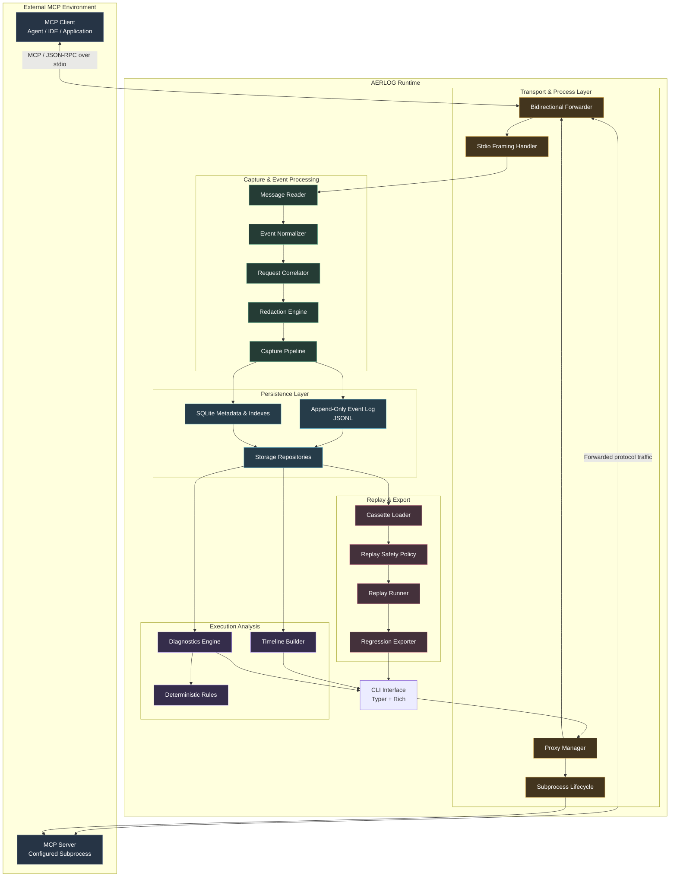
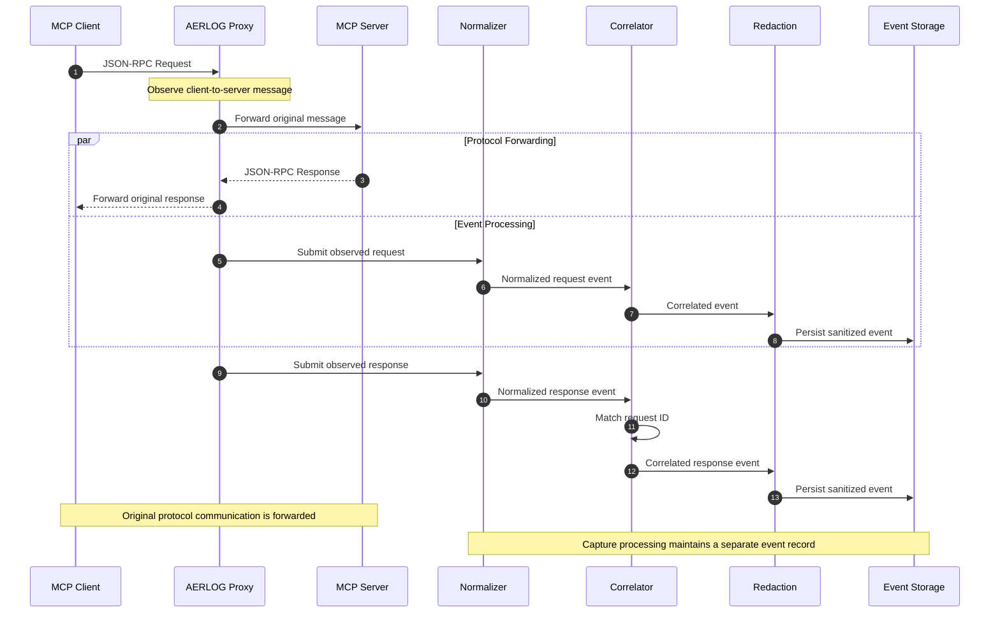
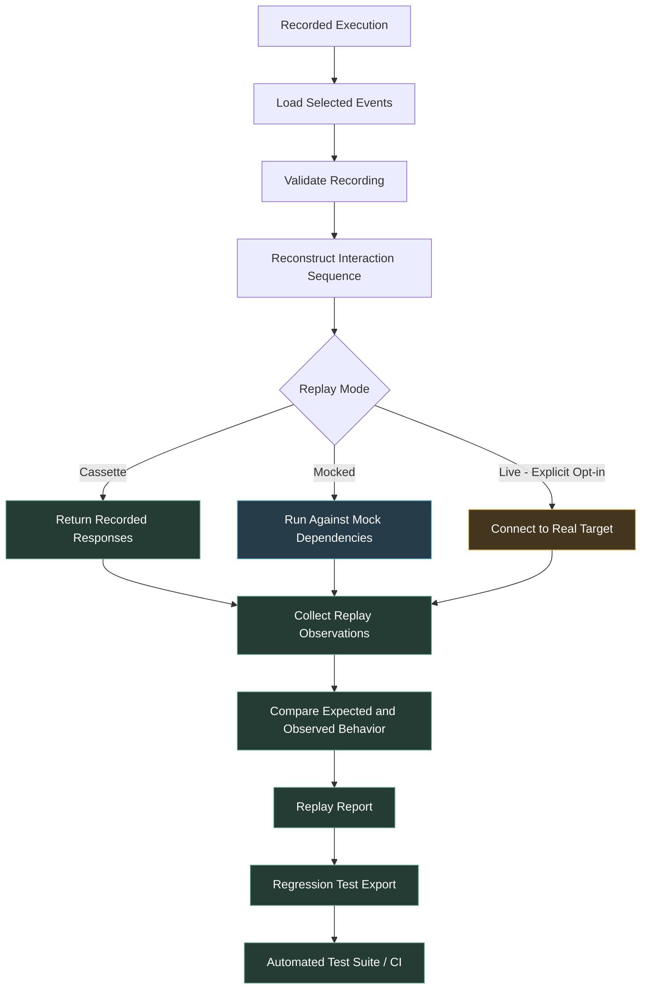
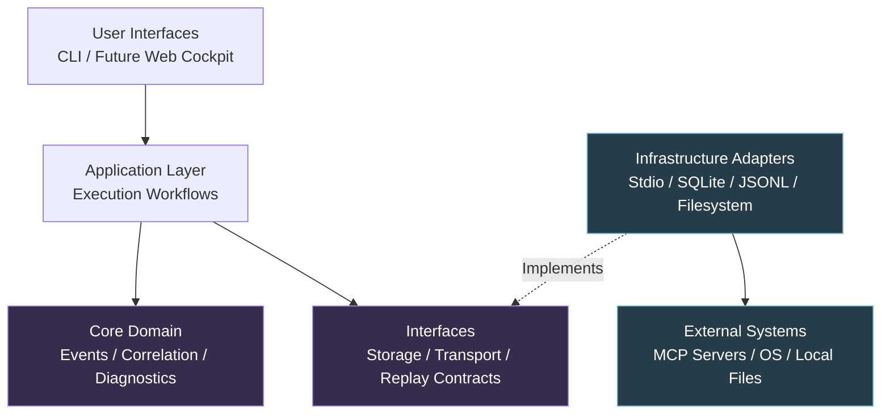

 <div align="center">

# AERLOG

### Agent Execution Recorder & Log

**Record. Reconstruct. Replay. Improve.**

A local-first observability, debugging, and reliability workbench for MCP-powered AI agents.

[](#project-status)
[](https://modelcontextprotocol.io/)
[](https://www.python.org/)
[](LICENSE)

*An execution-level flight recorder for AI agents. Capture observable interactions, reconstruct execution histories, investigate failures, and turn real-world failures into repeatable tests.*

</div>

---

## Table of Contents

- [Overview](#overview)
- [The Problem](#the-problem)
- [What is AERLOG?](#what-is-aerlog)
- [Design Principles](#design-principles)
- [Core Capabilities](#core-capabilities)
- [System Architecture](#system-architecture)
  - [Architecture Diagram](#1-high-level-system-architecture)
  - [Execution Capture Sequence](#2-execution-capture-sequence)
  - [Replay and Regression Lifecycle](#3-replay-and-regression-lifecycle)
  - [Architectural Boundaries](#4-architectural-dependency-boundaries)
  - [Subsystem Responsibilities](#5-subsystem-responsibilities)
- [Internal System Design](#internal-system-design)
  - [Transparent Stdio Proxy](#1-transparent-stdio-proxy)
  - [Capture Pipeline](#2-capture-pipeline)
  - [Event Model](#3-event-model)
  - [Request and Response Correlation](#4-request-and-response-correlation)
  - [Storage Architecture](#5-storage-architecture)
  - [Diagnostics Engine](#6-diagnostics-engine)
  - [Replay Architecture and Safety](#7-replay-architecture-and-safety)
  - [Privacy and Data Handling](#8-privacy-and-data-handling)
- [Repository Structure](#repository-structure)
- [Technology Stack](#technology-stack)
- [MVP Scope and Milestones](#mvp-scope-and-milestones)
- [CLI Experience](#cli-experience)
- [Testing Strategy](#testing-strategy)
- [Security and Trust Boundaries](#security-and-trust-boundaries)
- [Compatibility and Limitations](#compatibility-and-limitations)
- [Competitive Landscape and Positioning](#competitive-landscape-and-positioning)
- [Development Setup](#development-setup)
- [Contributing](#contributing)
- [Future Directions](#future-directions)
- [Project Status](#project-status)
- [License](#license)

---

## Overview

AI agents increasingly depend on external tools, services, and execution environments to accomplish complex tasks.

The Model Context Protocol (MCP) provides a standardized way for applications to communicate with external tools and context providers. However, observing an agent's tool interactions is not the same as understanding the complete execution that produced them.

When an agent fails, developers need to understand the sequence of observable events that led to the failure, identify where the interaction stopped behaving as expected, and reproduce the relevant behavior without blindly repeating potentially destructive operations.

**AERLOG aims to provide that missing execution-level reliability workflow.**

It introduces a local-first recording layer around MCP communication, converting protocol interactions and process lifecycle events into structured, inspectable execution records.

Its intended workflow is:

**Capture → Inspect → Diagnose → Replay → Regression-test**

AERLOG is designed as a developer tool rather than another agent runtime. It does not make decisions on behalf of the agent or attempt to reconstruct private model reasoning. It focuses on collecting and analyzing the evidence available at the execution boundary.

## The Problem

An agent task is rarely a single request.

A seemingly simple operation may involve:

- Multiple model interactions.
- Tool discovery and selection.
- MCP requests and responses.
- Notifications and asynchronous events.
- Retries and repeated tool calls.
- Timeouts, cancellations, and server failures.
- External operations with potentially irreversible side effects.

When something goes wrong, the available evidence is often scattered across application logs, terminal output, server logs, and provider-specific observability tools.

This creates several debugging problems.

| Question | What developers need |
|---|---|
| What happened? | A chronological record of observable execution events. |
| Which tool was called? | Request details, arguments, responses, and correlation. |
| Where did execution stop? | Failure localization using protocol and process evidence. |
| Was the failure recoverable? | Visibility into retries, subsequent responses, and execution state. |
| Can it be reproduced? | A controlled replay of the captured interaction. |
| Did the fix work? | A repeatable regression test based on the original failure. |

Traditional logging provides individual records, but does not necessarily reconstruct a coherent execution history.

General-purpose LLM observability platforms can provide model-level traces, metrics, and evaluation workflows, but they do not eliminate the need for protocol-level inspection and controlled replay.

AERLOG focuses on this narrower engineering problem.

## What is AERLOG?

AERLOG is a proposed **local-first MCP execution recorder and reliability workbench**.

In its initial architecture, AERLOG operates as a transparent stdio proxy between an MCP client and an MCP server process.

It observes communication passing through this boundary, records relevant process and transport events, and converts protocol messages into a structured execution history.

Developers can then:

1. Inspect individual executions and their event timelines.
2. Correlate MCP requests with their responses.
3. Investigate observable failures and suspicious behavior.
4. Replay captured interactions through controlled cassettes.
5. Export captured scenarios as regression tests.

> Turn an opaque agent-tool interaction into an inspectable, reproducible, and testable engineering artifact.

### Design Goals

| Principle | Engineering objective |
|---|---|
| Protocol transparency | Forward supported transport traffic without changing its meaning. |
| Execution visibility | Preserve observable requests, responses, notifications, timing, and lifecycle events. |
| Evidence-based diagnosis | Explain failures using identifiable events rather than speculative root causes. |
| Reproducibility | Convert recorded interactions into reusable test material. |
| Safe by default | Never automatically repeat potentially consequential operations. |
| Local-first | Keep recordings and indexes on the developer's machine by default. |
| Extensibility | Support additional transports, instrumentation, and diagnostics through explicit interfaces. |
| Inspectability | Keep event records, configuration, and system behavior understandable to developers. |

### Non-Goals

The initial release is not intended to be:

- A replacement for MCP clients, MCP servers, or MCP SDKs.
- A complete agent runtime or orchestration framework.
- A model reasoning debugger or private chain-of-thought extractor.
- A general-purpose LLM observability platform.
- An autonomous agent that modifies code or executes recovery actions.
- A distributed observability backend requiring Kubernetes, Kafka, or cloud infrastructure.
- A guarantee that all agent failures can be identified from protocol traffic alone.

---

## Core Capabilities

The following capabilities describe the intended product. They are not claims that the features have already been implemented.

### 1. MCP Execution Capture

Observe communication between an MCP client and a configured server through a local stdio proxy.

Capture candidates include:

- JSON-RPC requests and responses.
- Notifications and protocol lifecycle messages.
- Tool calls and their observable results.
- Request IDs and message relationships.
- Wall-clock and monotonic timestamps.
- Request durations and timeout information.
- Server process lifecycle.
- Standard error output.
- Transport failures and capture warnings.

Unknown JSON-RPC methods and fields should be preserved wherever possible. AERLOG should not silently discard information simply because a particular protocol method is not yet understood by its analysis layer.

### 2. Execution Timeline Reconstruction

Convert captured events into a correlated execution timeline.

An execution inspector should eventually provide:

- Chronological event ordering.
- Request/response relationships.
- Tool names and observable arguments.
- Response payloads and protocol errors.
- Request durations.
- Process startup and shutdown events.
- Timeouts and cancellation signals.
- Unmatched messages and incomplete interactions.
- Diagnostic annotations linked to supporting evidence.

The timeline must distinguish observed events from inferred interpretations.

### 3. Evidence-Based Failure Diagnostics

AERLOG should identify observable failure patterns through deterministic, explainable rules.

| Diagnostic signal | Possible interpretation |
|---|---|
| Request without a matching response | Timeout, disconnect, or incomplete capture. |
| JSON-RPC error response | Explicit protocol or server-reported error. |
| Unexpected server process exit | Server crash or premature shutdown. |
| Repeated equivalent tool calls | Possible retry loop or lack of progress. |
| Repeated timeout pattern | Potentially unavailable or unresponsive dependency. |
| Tool error followed by apparent task completion | Potential false-success condition requiring investigation. |
| Response without a matching request | Unmatched response or incomplete recording. |

Every diagnostic should include its evidence, severity, explanation, and limitations.

A repeated request is not automatically a loop. A timeout is not automatically a server bug. Diagnostics should identify suspicious behavior without pretending to know the agent's private intent.

### 4. Controlled Replay

Captured interactions should become reusable test material.

Planned replay modes:

| Mode | Description | Execution risk |
|---|---|---|
| Inspect | Read and analyze recorded interactions. | None |
| Cassette | Return recorded responses without contacting the original server. | Low |
| Mocked replay | Run a controlled test using mocked dependencies. | Controlled |
| Live replay | Execute interactions against a real target server. | High; explicit opt-in only |

Cassette replay is the initial priority.

Live replay must never be the default. Recorded requests may represent payments, file modifications, deployments, messages, or other operations with external side effects.

### 5. Regression Test Generation

A captured execution should be exportable into a portable test fixture.

Potential exported material:

- Selected request/response sequences.
- Expected JSON-RPC behavior.
- Relevant notification sequences.
- Response-shape assertions.
- Error-handling assertions.
- Timing expectations where meaningful.
- Fixture provenance and redaction metadata.

The goal is to turn a debugging session into a repeatable test that can be executed locally or in CI.

### 6. Local Developer Cockpit

The first interface is a CLI.

A local web cockpit is a later milestone, intended to provide:

- Execution discovery and search.
- Chronological event timelines.
- Request and response inspection.
- Diagnostic evidence.
- Replay configuration and safety warnings.
- Regression test export.
- Execution comparison.

The interface should be built on top of the same core application workflows as the CLI rather than introducing a separate implementation of the recording logic.

---

# System Architecture

AERLOG follows a modular architecture with clearly separated transport, capture, domain, persistence, and application layers.

The central design principle is that **the proxy observes and forwards; the capture pipeline records; the analysis layer interprets; and the replay subsystem controls reproduction.**

The initial implementation is a modular Python application, not a collection of distributed services.

## 1. High-Level System Architecture

The following diagram illustrates the major components and their relationships, including the external MCP environment, AERLOG runtime, capture pipeline, execution analysis, and persistent storage.



### Architecture Overview

| Layer | Responsibility |
|---|---|
| External MCP environment | Client and configured MCP server process. |
| Transport and process | Starts the server, manages subprocess streams, and forwards traffic. |
| Capture and events | Observes messages, normalizes events, correlates requests, and redacts data. |
| Persistence | Stores the event stream and queryable execution metadata. |
| Execution analysis | Reconstructs timelines and generates evidence-backed diagnostics. |
| Replay and export | Loads recordings, controls replay behavior, and generates regression fixtures. |
| Application interface | Coordinates user workflows through the CLI and future cockpit. |

The proxy and capture pipeline are deliberately separated. Analysis should not be responsible for maintaining a live transport connection, and storage should not contain protocol-forwarding logic.

## 2. Execution Capture Sequence

This sequence illustrates how an MCP request moves through the initial stdio architecture.

AERLOG launches the configured server subprocess. The MCP client communicates with that process through the proxy, while the proxy observes both directions of communication.



### Capture Lifecycle

1. The developer starts an execution through AERLOG.
2. The proxy launches the configured MCP server subprocess.
3. The MCP client sends a message to the proxy.
4. The proxy observes and forwards the message.
5. The server processes the request and sends its response.
6. The proxy forwards the response to the client.
7. Observations are normalized and associated with the execution.
8. Events are correlated and passed through configured redaction.
9. Events and metadata are persisted.
10. The completed or interrupted execution becomes available for inspection.

**Correctness requirement:** Capture must not silently corrupt the original protocol stream. Buffering, bounded queues, backpressure, and storage failures require explicit policies. If capture becomes incomplete, AERLOG must expose that fact rather than presenting the recording as complete.

## 3. Replay and Regression Lifecycle

Recording an execution is only the beginning. The captured evidence should become useful beyond the original debugging session.

The replay subsystem consumes stored recordings and reconstructs selected interactions in a controlled environment.



### Replay Design Rules

- Inspect mode must not execute recorded operations.
- Cassette mode must not contact the original server.
- Mocked replay must make dependency boundaries explicit.
- Live replay requires explicit user authorization and a visible target.
- Potentially consequential operations must never be automatically repeated.
- Replay results must be stored separately from original capture records.
- A replay mismatch should identify the relevant expected and observed events.

A recording is evidence of what happened. It is not authorization to repeat the operation.

## 4. Architectural Dependency Boundaries

AERLOG should keep its core domain independent of transport implementations, storage backends, and user interfaces.

The intended dependency direction is:



### Architectural Rules

1. **Transport independence:** Diagnostic rules must not depend on stdio implementation details.
2. **Domain independence:** Event models and correlation logic must not depend on SQLite or the CLI.
3. **Storage isolation:** Persistence adapters must not own diagnostic or replay policies.
4. **Replay isolation:** Replay must consume recorded data through explicit interfaces.
5. **Interface consistency:** CLI and future UI workflows should use the same application services.
6. **Replaceable infrastructure:** Storage and transport implementations should be replaceable without rewriting the core domain.
7. **Explicit side effects:** Any component that can execute an external action must have a clearly defined safety boundary.

This is a modular application architecture. It does not require a microservice for every subsystem.

## 5. Subsystem Responsibilities

| Subsystem | Proposed location | Responsibilities |
|---|---|---|
| CLI | `cli/` | User commands and workflow orchestration. |
| Application | `application/` | Coordinates execution, inspection, replay, and export workflows. |
| Proxy | `proxy/` | Subprocess management and bidirectional forwarding. |
| Protocol | `protocol/` | Framing, JSON-RPC parsing, and compatibility. |
| Capture | `capture/` | Message observation, normalization, and redaction. |
| Events | `events/` | Event contracts, execution identity, and correlation. |
| Storage | `storage/` | Event logs, metadata, indexes, and repositories. |
| Analysis | `analysis/` | Timeline reconstruction and diagnostics. |
| Replay | `replay/` | Cassette loading, controlled replay, and safety policies. |
| Export | `export/` | Regression fixture and test generation. |
| Configuration | `config/` | Runtime settings, server definitions, and redaction policies. |

---

# Internal System Design

## 1. Transparent Stdio Proxy

The first implementation targets the MCP stdio transport.

The proxy acts as a subprocess intermediary:

- The MCP client communicates with AERLOG through stdin/stdout.
- AERLOG launches the configured MCP server process.
- AERLOG forwards client input to the server's stdin.
- AERLOG forwards server stdout to the client's stdout.
- Server stderr is captured separately.

### Responsibilities

- Start and manage the configured server subprocess.
- Maintain independent client-to-server and server-to-client forwarding paths.
- Preserve message boundaries, framing, and ordering.
- Observe protocol messages in both directions.
- Capture process startup, stderr, termination, and exit status.
- Handle broken pipes and subprocess failures.
- Support cancellation and graceful shutdown.
- Apply bounded buffering and explicit backpressure policies.

### Protocol Integrity

For MCP stdio communication:

- Messages use the framing defined by the MCP stdio transport specification.
- Each message is encoded as a UTF-8 JSON-RPC message followed by a newline.
- Server stdout is reserved for protocol messages.
- Server diagnostics and logging belong on stderr.
- The proxy must not assume that one operating-system read corresponds to one complete protocol message.

AERLOG must parse and forward messages without injecting diagnostic output into the protocol stream.

Where possible, unknown methods and fields should remain intact. Parsing failures should be surfaced as capture warnings rather than silently discarded.

### Failure Handling

The proxy must account for:

| Failure | Required behavior |
|---|---|
| Server fails to start | Report startup failure and clean up resources. |
| Client disconnects | Terminate or clean up the child process according to the lifecycle policy. |
| Server exits early | Preserve exit information and close forwarding paths safely. |
| Broken pipe | Record transport failure and stop invalid forwarding. |
| Malformed message | Preserve available evidence and report a parsing warning. |
| Capture queue saturation | Apply an explicit backpressure or incomplete-capture policy. |
| Cancellation | Propagate cancellation and release subprocess resources. |
| Shutdown timeout | Escalate cleanup according to the configured process policy. |

The proxy's primary responsibility is protocol correctness, not diagnosis.

## 2. Capture Pipeline

The capture pipeline converts transport observations into durable execution events.

Its stages are:

```text
Transport Observation
        |
        v
Message Reader
        |
        v
Protocol Normalization
        |
        v
Request / Response Correlation
        |
        v
Sensitive Data Redaction
        |
        v
Event Validation
        |
        v
Persistence
```

### Pipeline Responsibilities

| Stage | Responsibility |
|---|---|
| Message reader | Receives complete framed messages from forwarding paths. |
| Normalizer | Creates a consistent internal representation. |
| Correlator | Associates requests and responses. |
| Redaction | Applies configured sensitive-data handling. |
| Validator | Checks event structure and schema compatibility. |
| Persistence | Appends event records and updates metadata. |

The capture pipeline should use bounded buffering rather than unbounded in-memory queues.

A critical trade-off must be documented: if the storage system cannot keep up, AERLOG must decide whether to apply backpressure, stop capture, or mark the execution incomplete. It must never silently drop events while claiming to have a complete recording.

The initial implementation should favor correctness and explicit failure reporting over premature throughput optimization.

## 3. Event Model

An execution is represented by an ordered sequence of structured events.

A conceptual event envelope:

```json
{
  "schema_version": 1,
  "event_id": "evt_01...",
  "execution_id": "exec_01...",
  "sequence": 12,
  "timestamp": "2026-11-11T10:30:00.000Z",
  "monotonic_time_ns": 123456789000,
  "direction": "client_to_server",
  "kind": "jsonrpc_request",
  "request_id": "42",
  "method": "tools/call",
  "payload": {
    "name": "example_tool",
    "arguments": {}
  },
  "transport": "stdio"
}
```

This is an illustrative schema, not a finalized wire format.

### Event Categories

| Event kind | Description |
|---|---|
| `process_started` | Server subprocess successfully started. |
| `process_stderr` | Server emitted diagnostic output. |
| `jsonrpc_request` | A JSON-RPC request was observed. |
| `jsonrpc_response` | A JSON-RPC response was observed. |
| `jsonrpc_notification` | A notification was observed. |
| `transport_error` | A forwarding or transport error occurred. |
| `timeout` | A timeout was observed or declared by AERLOG. |
| `process_exited` | Server subprocess terminated. |
| `capture_warning` | A limitation or recording issue occurred. |
| `capture_gap` | A known gap exists in the recorded event sequence. |

### Core Fields

| Field | Purpose |
|---|---|
| `schema_version` | Supports event-format evolution. |
| `event_id` | Identifies an individual event. |
| `execution_id` | Groups events into an execution. |
| `sequence` | Defines observed event order within an execution. |
| `timestamp` | Human-readable wall-clock timestamp. |
| `monotonic_time_ns` | Supports reliable duration calculations. |
| `direction` | Identifies the observation direction. |
| `kind` | Identifies the event category. |
| `request_id` | Correlation key where applicable. |
| `method` | JSON-RPC method where applicable. |
| `payload` | Structured or raw protocol content. |
| `transport` | Identifies the transport implementation. |

### Timing Semantics

Both wall-clock and monotonic timing should be recorded where possible.

- Wall-clock timestamps are useful for human inspection and cross-system context.
- Monotonic timestamps are more reliable for calculating durations within one process execution.
- Sequence numbers preserve the order in which observations are recorded.
- AERLOG should distinguish observed timestamps from derived duration measurements.

## 4. Request and Response Correlation

JSON-RPC request IDs provide the primary mechanism for associating requests with their corresponding responses.

The correlator should:

- Track outstanding requests.
- Match responses to their request IDs.
- Scope request tracking to the relevant connection or session.
- Preserve original request IDs and their JSON types.
- Handle out-of-order responses.
- Record unmatched responses.
- Identify requests without observed responses.
- Preserve notifications, which do not expect responses.
- Handle identifier reuse without confusing separate outstanding requests.

A missing response is evidence of an incomplete interaction. It does not prove that the server failed to process the request.

The correlation layer must retain that distinction so that diagnostics do not overstate what the capture establishes.

## 5. Storage Architecture

AERLOG uses two complementary local persistence mechanisms.

### A. Append-Only JSONL Event Log

The event log is the durable record of captured execution events.

Responsibilities:

- Store structured events in sequence.
- Preserve the original observation history subject to redaction.
- Support streaming and offline inspection.
- Allow export and fixture processing.
- Make event data accessible without requiring a database server.

Each execution should have a clearly defined recording boundary and manifest.

### B. SQLite Metadata and Indexes

SQLite provides queryable execution metadata and indexes.

Responsibilities:

- Execution identifiers and summaries.
- Start and end timestamps.
- Event counts and recording status.
- Event offsets or references.
- Request/response relationships.
- Diagnostic summaries.
- Replay metadata.
- Search and filtering.

SQLite should be treated as an index and metadata store, not as an independent source of truth that can silently contradict the event log.

### C. Conceptual Storage Layout

```text
~/.local/share/aerlog/
│
├── config.toml
│
├── executions/
│   ├── <execution-id>/
│   │   ├── events.jsonl
│   │   ├── execution.json
│   │   └── manifest.json
│   │
│   └── <execution-id>/
│       ├── events.jsonl
│       ├── execution.json
│       └── manifest.json
│
├── aerlog.db
│
└── logs/
    └── aerlog.log
```

The final location should follow operating-system conventions and remain configurable.

### D. Storage Integrity

The implementation should consider:

- Atomic metadata updates.
- Partial recordings after crashes.
- Incomplete final JSONL records.
- SQLite transactions and migrations.
- Event schema versioning.
- Recording manifests.
- Checksums or integrity metadata where useful.
- Recovery of incomplete executions.

A partially written execution must not be presented as a fully successful recording.

## 6. Diagnostics Engine

The first diagnostics implementation should be deterministic and explainable.

No LLM-based failure classifier is required for the MVP.

Every diagnostic should contain:

- A stable diagnostic code.
- Severity.
- A concise explanation.
- Supporting event IDs.
- Confidence or certainty semantics.
- Known limitations.
- A suggested investigation step.

### Example Diagnostic

```json
{
  "code": "REQUEST_WITHOUT_RESPONSE",
  "severity": "warning",
  "message": "A request was observed without a matching response.",
  "evidence": [
    "evt_11",
    "evt_18"
  ],
  "confidence": "observed",
  "limitations": "The capture cannot determine whether the server completed the operation before the connection ended."
}
```

The diagnostics engine should distinguish:

- Directly observed protocol errors.
- Observed transport failures.
- Inferred execution patterns.
- Potential behavioral problems.

AERLOG should not turn a plausible explanation into a factual root-cause claim.

## 7. Replay Architecture and Safety

Replay consumes stored recordings and reconstructs selected protocol interactions.

The initial implementation should focus on cassette-based replay.

### Cassette Replay

In cassette mode:

1. Load the selected recording.
2. Validate the event sequence and schema version.
3. Select the relevant interaction sequence.
4. Match incoming requests against recorded requests.
5. Return the corresponding recorded responses.
6. Record mismatches and replay outcomes.
7. Generate a replay report.

Cassette replay must not connect to the original MCP server.

### Live Replay

Live replay is a separate, higher-risk capability.

It may eventually support controlled re-execution against a real server, but must require explicit user authorization.

Safety requirements:

- Never automatically replay destructive operations.
- Clearly display the target and replay mode.
- Do not assume read-like method names guarantee safe behavior.
- Do not execute embedded commands from recordings.
- Keep original recordings immutable.
- Record replay activity separately.
- Make external side effects explicit.
- Provide clear warnings before live execution.

AERLOG should not claim that it can guarantee safe replay of arbitrary MCP tools.

## 8. Privacy and Data Handling

MCP traffic may contain credentials, private file contents, internal prompts, personal information, and business data.

AERLOG should therefore use a local-first privacy model.

### Privacy Requirements

1. **Local-first recording:** No remote upload by default.
2. **Pre-persistence redaction:** Configured sensitive data should be removed or masked before durable storage.
3. **Configurable policies:** Support sensitive-field patterns and user-defined redaction rules.
4. **Secret handling:** Avoid capturing environment variables and secrets from subprocess configuration.
5. **Restricted permissions:** Protect local execution recordings using appropriate filesystem permissions.
6. **Export awareness:** Warn before sharing raw recordings.
7. **Redaction visibility:** Indicate when content has been redacted.
8. **Explicit limitations:** Explain that payload capture may expose sensitive information.

Redaction must be testable and predictable. AERLOG must not silently present a modified payload as if it were the complete original message.

---

# Repository Structure

The following is the proposed modular repository layout. It describes the intended architecture, not a claim that all modules currently exist.

```text
aerlog/
│
├── README.md
├── LICENSE
├── NOTICE
├── pyproject.toml
├── .gitignore
├── .python-version
│
├── docs/
│   ├── architecture/
│   │   ├── overview.md
│   │   ├── capture-pipeline.md
│   │   ├── event-model.md
│   │   ├── storage.md
│   │   ├── replay-and-safety.md
│   │   └── decisions/
│   │       ├── 0001-python-core.md
│   │       ├── 0002-stdio-proxy-first.md
│   │       └── 0003-jsonl-and-sqlite.md
│   │
│   ├── protocol/
│   │   └── compatibility.md
│   │
│   ├── security/
│   │   └── threat-model.md
│   │
│   └── development/
│       └── testing.md
│
├── src/
│   └── aerlog/
│       ├── __init__.py
│       ├── __main__.py
│       │
│       ├── cli/
│       │   ├── app.py
│       │   └── commands/
│       │       ├── run.py
│       │       ├── list.py
│       │       ├── inspect.py
│       │       ├── timeline.py
│       │       ├── replay.py
│       │       └── export.py
│       │
│       ├── application/
│       │   ├── execution.py
│       │   ├── inspection.py
│       │   ├── replay.py
│       │   └── export.py
│       │
│       ├── proxy/
│       │   ├── manager.py
│       │   ├── subprocess.py
│       │   ├── forwarding.py
│       │   └── lifecycle.py
│       │
│       ├── protocol/
│       │   ├── framing.py
│       │   ├── jsonrpc.py
│       │   ├── messages.py
│       │   └── compatibility.py
│       │
│       ├── capture/
│       │   ├── reader.py
│       │   ├── pipeline.py
│       │   ├── normalizer.py
│       │   └── redaction.py
│       │
│       ├── events/
│       │   ├── models.py
│       │   ├── types.py
│       │   └── correlation.py
│       │
│       ├── storage/
│       │   ├── event_log.py
│       │   ├── database.py
│       │   ├── repositories.py
│       │   └── migrations/
│       │
│       ├── analysis/
│       │   ├── timeline.py
│       │   ├── diagnostics.py
│       │   └── rules/
│       │
│       ├── replay/
│       │   ├── cassette.py
│       │   ├── runner.py
│       │   └── safety.py
│       │
│       ├── export/
│       │   └── regression.py
│       │
│       └── config/
│           ├── loader.py
│           └── schema.py
│
├── tests/
│   ├── unit/
│   │   ├── test_framing.py
│   │   ├── test_correlation.py
│   │   ├── test_redaction.py
│   │   ├── test_diagnostics.py
│   │   └── test_event_models.py
│   │
│   ├── integration/
│   │   ├── test_stdio_proxy.py
│   │   ├── test_capture_pipeline.py
│   │   ├── test_storage_recovery.py
│   │   └── test_cassette_replay.py
│   │
│   ├── fixtures/
│   │   ├── servers/
│   │   └── recordings/
│   │
│   └── conftest.py
│
├── examples/
│   ├── demo_mcp_server.py
│   ├── timeout_scenario.py
│   └── repeated_call_scenario.py
│
└── web/                         # Future local cockpit
    ├── package.json
    ├── src/
    └── README.md
```

### Module Boundaries

| Module | Ownership |
|---|---|
| `cli/` | Parses commands and presents results. |
| `application/` | Coordinates complete user-facing workflows. |
| `proxy/` | Owns subprocess and stream lifecycle. |
| `protocol/` | Owns message framing and JSON-RPC interpretation. |
| `capture/` | Owns observation, normalization, and redaction. |
| `events/` | Owns event contracts and correlation primitives. |
| `storage/` | Owns persistence and retrieval. |
| `analysis/` | Owns timelines and diagnostic rules. |
| `replay/` | Owns cassette behavior and replay safety. |
| `export/` | Owns portable regression test generation. |
| `config/` | Owns runtime configuration and validation. |

Keep the application modular. Introduce additional processes or services only when a demonstrated requirement justifies them.

---

# Technology Stack

The initial stack prioritizes correctness, maintainability, and local execution.

| Area | Proposed technology | Reason |
|---|---|---|
| Core language | Python 3.11+ | Product iteration and mature tooling ecosystem. |
| Async runtime | `asyncio` | Concurrent subprocess streams and cancellation. |
| Process management | `asyncio.subprocess` | Child process lifecycle and pipe handling. |
| MCP integration | Official MCP Python SDK where appropriate | Protocol compatibility and interoperability. |
| Protocol layer | Explicit JSON-RPC/framing implementation where required | Transparent observation and preservation. |
| Data validation | Pydantic | Typed event and configuration models. |
| Event persistence | JSONL | Simple, inspectable, append-oriented records. |
| Metadata database | SQLite | Local indexing and queries without a separate service. |
| CLI | Typer + Rich | Readable terminal interface. |
| Local API (later) | FastAPI | Backend for the future cockpit. |
| Web UI (later) | React + TypeScript + Vite | Familiar developer-facing interface. |
| Testing | pytest | Unit, integration, and fixture-based tests. |
| Code quality | Ruff | Linting and formatting. |
| Optional telemetry | OpenTelemetry | Future trace-context interoperability. |

### Why Not Start With...?

| Technology / approach | Reason for exclusion from the MVP |
|---|---|
| Kafka | Distributed event infrastructure is unnecessary for an initial local recorder. |
| Redis | No demonstrated requirement for a shared cache or queue. |
| Kubernetes | The initial product is a local developer tool. |
| Vector database | The core problem is structured protocol evidence, not semantic retrieval. |
| LLM-based diagnostics | Deterministic rules are easier to test and explain. |
| Hosted dashboard | The local capture and replay workflow must prove its value first. |
| Microservices | Additional deployment and operational complexity without an established need. |

These technologies are not inherently unsuitable. They should be considered when actual requirements justify them.

---

# MVP Scope and Milestones

The MVP should prove one complete, useful engineering workflow:

> Capture one real MCP execution, persist its observable events, reconstruct its timeline, and correctly identify a simulated timeout.

### Milestone Plan

- [ ] **M0 — Protocol spike**
  - Study MCP stdio transport behavior.
  - Build a minimal test MCP server and client.
  - Verify message framing and process lifecycle.

- [ ] **M1 — Transparent proxy**
  - Launch a configured server subprocess.
  - Forward traffic in both directions.
  - Preserve stdout protocol integrity.
  - Handle cancellation and subprocess cleanup.

- [ ] **M2 — Event capture**
  - Capture requests, responses, and notifications.
  - Record process and transport events.
  - Normalize events and persist them.

- [ ] **M3 — Correlation and timeline**
  - Match requests and responses.
  - Preserve event ordering.
  - Build a readable execution timeline.

- [ ] **M4 — Deterministic diagnostics**
  - Detect missing responses.
  - Identify observed timeouts.
  - Capture explicit protocol errors.
  - Detect unexpected process termination.

- [ ] **M5 — Cassette replay**
  - Load stored executions.
  - Validate recording integrity.
  - Replay recorded responses without contacting the original server.

- [ ] **M6 — Regression export**
  - Generate portable fixtures.
  - Produce repeatable protocol tests.
  - Verify exported tests against deterministic scenarios.

- [ ] **M7 — Local cockpit**
  - Add execution discovery.
  - Visualize event timelines.
  - Inspect diagnostics and payloads.
  - Provide replay and export controls.

### MVP Acceptance Criteria

The first usable milestone is complete only when:

1. AERLOG launches a test MCP server as a subprocess.
2. An MCP client communicates through the proxy successfully.
3. Both directions of protocol traffic are captured.
4. Captured events remain accessible after process termination.
5. Request/response relationships are correctly reconstructed.
6. A deliberately delayed or missing response is identified with supporting evidence.
7. Capture does not corrupt the protocol stream.
8. Incomplete recordings are distinguishable from complete ones.
9. Tests cover normal operation, timeouts, malformed input, process exits, and cancellation.

A web dashboard is not required to meet these criteria.

---

# CLI Experience

The following commands describe the intended developer experience. They are illustrative until implemented.

```bash
# Start a server through AERLOG
aerlog run -- python examples/demo_mcp_server.py

# List recorded executions
aerlog executions list

# Inspect a specific execution
aerlog inspect <execution-id>

# View its chronological timeline
aerlog timeline <execution-id>

# Replay recorded interactions without contacting the original server
aerlog replay <execution-id> --mode cassette

# Export a regression test
aerlog export test <execution-id> --output tests/generated/
```

### Example Inspection Output

```text
AERLOG EXECUTION INSPECTOR

Execution:  exec_01J...
Status:     COMPLETED_WITH_WARNINGS
Duration:   2.41s
Events:     12
Transport:  stdio

TIMELINE

TIME       DIRECTION         EVENT
------------------------------------------------
00.000s    client -> server  initialize
00.031s    server -> client  initialize result
00.044s    client -> server  tools/list
00.062s    server -> client  tools/list result
00.081s    client -> server  tools/call
02.081s    internal          request timeout

DIAGNOSTICS

[WARN] REQUEST_WITHOUT_RESPONSE

Request ID: 42
Method:     tools/call
Evidence:   evt_09, evt_12

The request was observed without a matching response
before the configured timeout.

Limitation:
The recording cannot establish whether the server
completed the operation before the connection ended.
```

---

# Testing Strategy

A reliability tool must itself be reliable.

Tests should validate both the behavior of the proxy and the correctness of the evidence it produces.

## 1. Unit Tests

- Message framing and parsing.
- JSON-RPC message classification.
- Event schema validation.
- Event version compatibility.
- Request/response correlation.
- Sequence and timestamp handling.
- Duration calculations.
- Redaction policies.
- Diagnostic rule behavior.
- Replay safety policies.

## 2. Integration Tests

Use small deterministic MCP test servers to simulate:

- Successful initialization.
- Tool discovery and tool calls.
- Delayed responses and timeouts.
- Explicit JSON-RPC errors.
- Malformed messages.
- Notifications.
- Unmatched and out-of-order responses where valid.
- Server crashes and early termination.
- Large payloads and backpressure.
- Client cancellation.
- Graceful shutdown.
- Partial recordings and storage recovery.

## 3. Compatibility Tests

- Validate against supported MCP SDK versions.
- Verify stdio framing behavior.
- Preserve unknown JSON-RPC methods and fields.
- Test protocol edge cases.
- Maintain representative execution fixtures.
- Avoid depending on live third-party MCP servers in the core test suite.

## 4. Performance Checks

Measure actual behavior instead of assuming the proxy is lightweight.

Relevant metrics include:

- Message forwarding overhead.
- Capture throughput.
- Memory consumption.
- Queue saturation behavior.
- Storage growth.
- Timeline reconstruction time.
- Large-payload handling.

Performance targets should be established after reproducible baselines exist. No benchmark claims should be published without documented hardware, test conditions, and methodology.

---

# Security and Trust Boundaries

AERLOG observes potentially sensitive data and interacts with processes that may have access to a developer's machine.

Security must therefore be considered part of the architecture, not a feature added after the recorder works.

## Threat Model

| Threat | Mitigation direction |
|---|---|
| Secrets captured in payloads | Pre-persistence redaction and export warnings. |
| Malformed protocol input | Defensive parsing and bounded resource usage. |
| Unbounded memory growth | Bounded queues and backpressure. |
| Child process leakage | Process-group management and reliable cleanup. |
| Unsafe live replay | Explicit authorization and visible target boundaries. |
| Malicious exported fixtures | Treat recordings as data, never as executable commands. |
| Sensitive recordings shared accidentally | Redaction preview and export warnings. |
| Partial or corrupted recordings | Recovery handling and integrity metadata. |

## Trust Model

- The local developer controls the machine and selects the processes to run.
- MCP servers and their outputs are potentially untrusted.
- Captured payloads are potentially sensitive.
- Recordings are evidence, not executable instructions.
- AERLOG should not silently modify requests or responses.
- A successful capture does not prove that an external operation succeeded.
- Diagnostics are limited to observable evidence and explicitly supplied instrumentation.

A dedicated threat model should evolve alongside the implementation.

---

# Compatibility and Limitations

## What AERLOG Can Observe

When communication passes through its configured proxy, AERLOG can observe:

- Protocol messages.
- Request/response relationships.
- Notifications.
- Transport behavior.
- Available process lifecycle information.
- Observable timing and errors.
- Server stderr output.

## What AERLOG Cannot Observe by Default

- Private model reasoning or hidden chain-of-thought.
- Internal agent state never exposed through the observed boundary.
- Model prompts and responses exchanged through unrelated connections.
- Tool-side effects not represented in observable responses.
- Whether an external operation completed after a connection was lost.
- The actual intent behind a tool call.

Optional agent-side instrumentation may eventually supply explicit task IDs, model-call metadata, or application-level context.

Such metadata must be clearly distinguished from information observed by the proxy.

## Initial Transport Scope

The first implementation targets **MCP stdio transport**.

Additional transports should be considered after the stdio capture pipeline is reliable and their protocol and lifecycle requirements have been evaluated.

Compatibility claims should be tied to tested MCP SDK and protocol versions.

---

# Competitive Landscape and Positioning

AERLOG enters an ecosystem that already includes MCP inspection tools, record/replay utilities, and general-purpose LLM observability platforms.

It should not claim to be the first tool to record MCP traffic or replay interactions.

Its intended focus is an execution-centric reliability workflow:

1. Capture protocol interactions and process lifecycle.
2. Reconstruct correlated execution timelines.
3. Localize observable failures using evidence.
4. Replay captured interactions safely.
5. Generate regression tests from real failures.
6. Provide a local-first workflow without requiring a hosted observability account.

These are product hypotheses, not proof of an uncontested market.

The project should continuously compare its workflow against existing tools and narrow its scope if a simpler existing solution already addresses the same problem.

---

# Development Setup

The following describes the intended development workflow. Update commands and dependencies when the initial implementation is established.

## Requirements

- Python 3.11 or newer.
- Git.
- `uv` (recommended) or `pip`.
- A Unix-like environment for the initial subprocess development path.
- An MCP-compatible test client and server for integration testing.

## Clone the Repository

```bash
git clone https://github.com/<your-username>/aerlog.git
cd aerlog
```

## Install Development Dependencies

Once the project configuration is implemented:

```bash
uv sync --all-extras
```

## Run Tests and Checks

```bash
uv run pytest

uv run ruff check .

uv run ruff format --check .
```

The exact dependency groups and commands should remain synchronized with `pyproject.toml`.

## Suggested Development Workflow

1. Read the relevant MCP protocol and architecture documentation.
2. Identify the subsystem responsible for the behavior.
3. Reproduce the scenario using a minimal test server.
4. Define expected behavior and acceptance criteria.
5. Add or update a focused test.
6. Implement the smallest appropriate change.
7. Run relevant unit and integration tests.
8. Inspect the resulting event stream.
9. Verify protocol integrity and failure handling.
10. Document design decisions, compatibility changes, and limitations.

---

# Contributing

Contributions are welcome as the initial repository and implementation take shape.

Potential contribution areas include:

- MCP stdio compatibility.
- Robust subprocess and stream lifecycle management.
- Event schema design.
- Request/response correlation.
- Privacy-preserving recording and redaction.
- Storage integrity and recovery.
- Deterministic diagnostics.
- Cassette replay and regression testing.
- Cross-platform compatibility.
- Documentation and reproducible test scenarios.

Before proposing a substantial feature, open an issue describing:

- The problem being addressed.
- Expected behavior.
- Relevant architectural boundaries.
- Alternative implementation approaches.
- Testing requirements.
- Security and replay implications.

### Contribution Principles

- Correctness before features.
- Evidence before diagnosis.
- Safe defaults before convenience.
- Explicit interfaces and modular responsibilities.
- Tests for protocol and replay behavior.
- No unsupported compatibility or benchmark claims.
- Documentation for meaningful architectural changes.

---

# Future Directions

Potential directions beyond the initial release include:

| Area | Possible extension |
|---|---|
| Transport support | Additional MCP transport adapters. |
| Agent instrumentation | Explicit task and model-call context. |
| Observability | OpenTelemetry export and trace-context interoperability. |
| Diagnostics | More advanced retry-loop and non-progress detection. |
| Comparison | Side-by-side execution comparison. |
| Replay | Selective replay and fixture minimization. |
| Testing | CI integrations and machine-readable reports. |
| Extensibility | Custom diagnostic and redaction plugins. |
| Interface | Richer local web cockpit. |

These are exploratory directions, not commitments. Prioritize them only after the core capture, inspection, replay, and regression workflow is dependable.

---

# Project Status

> **Early design and implementation planning.**

The architecture, repository structure, CLI commands, and milestones in this README describe the intended direction of AERLOG. They should not be interpreted as evidence that the listed features, interfaces, compatibility guarantees, or performance characteristics are already implemented.

The first engineering objective is to build a transparent stdio proxy and a trustworthy event capture pipeline.

More ambitious functionality should be earned through tested, observable foundations.

---

# License

AERLOG is intended to be released under the **Apache License 2.0**.

Apache-2.0 permits use, modification, distribution, and commercial adoption while providing an explicit patent grant and requiring preservation of applicable license and attribution notices.

See [LICENSE](LICENSE) for the complete license text.

---

<div align="center">

**Make agent executions inspectable.**

**Make failures reproducible.**

**Make reliability testable.**

</div>