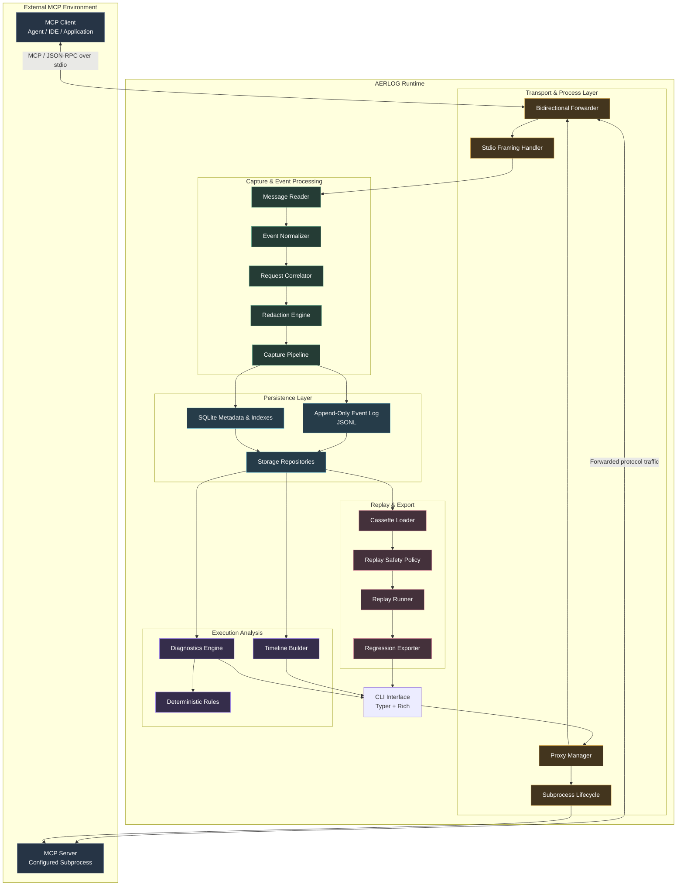
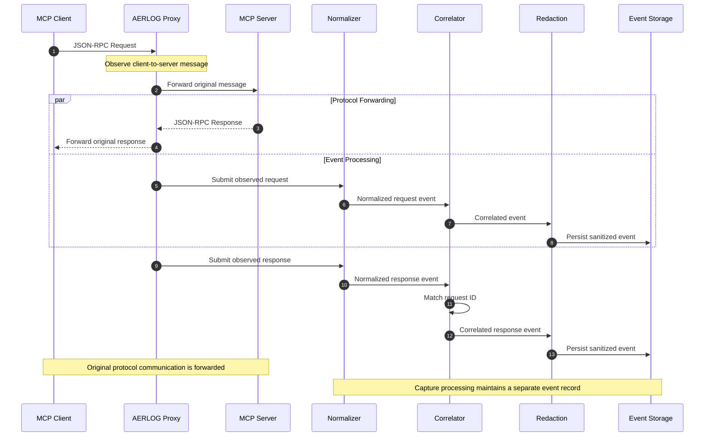
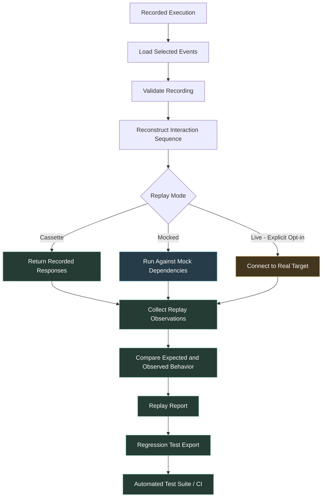
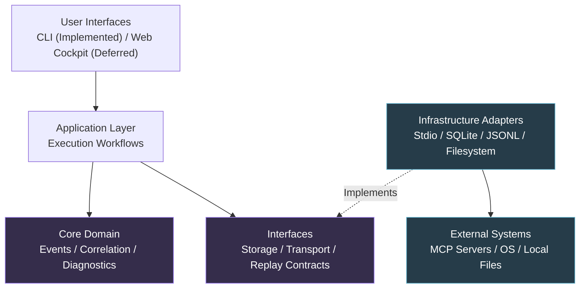

 <div align="center">

# AERLOG

### Agent Execution Recorder & Log

**Record. Reconstruct. Replay. Improve.**

A local-first observability, debugging, and reliability workbench for MCP-powered AI agents.

[](#project-status)
[](https://modelcontextprotocol.io/)
[](https://www.python.org/)
[](LICENSE)

*An execution-level flight recorder for AI agents. Capture observable interactions, reconstruct execution histories, investigate failures, and turn real-world failures into repeatable tests.*

</div>

---

## Table of Contents

- [Overview](#overview)
- [The Problem](#the-problem)
- [What is AERLOG?](#what-is-aerlog)
- [Design Goals](#design-goals)
- [Core Capabilities](#core-capabilities)
- [System Architecture](#system-architecture)
  - [Architecture Diagram](#1-high-level-system-architecture)
  - [Execution Capture Sequence](#2-execution-capture-sequence)
  - [Replay and Regression Lifecycle](#3-replay-and-regression-lifecycle)
  - [Architectural Boundaries](#4-architectural-dependency-boundaries)
  - [Subsystem Responsibilities](#5-subsystem-responsibilities)
- [Internal System Design](#internal-system-design)
  - [Transparent Stdio Proxy](#1-transparent-stdio-proxy)
  - [Capture Pipeline](#2-capture-pipeline)
  - [Event Model](#3-event-model)
  - [Request and Response Correlation](#4-request-and-response-correlation)
  - [Storage Architecture](#5-storage-architecture)
  - [Diagnostics Engine](#6-diagnostics-engine)
  - [Replay Architecture and Safety](#7-replay-architecture-and-safety)
  - [Privacy and Data Handling](#8-privacy-and-data-handling)
- [Repository Structure](#repository-structure)
- [Technology Stack](#technology-stack)
- [MVP Scope and Milestones](#mvp-scope-and-milestones)
- [CLI Experience](#cli-experience)
  - [60-Second Quickstart](#60-second-quickstart)
  - [Configuration Reference](#configuration-reference)
  - [Example Inspection Output](#example-inspection-output)
- [Testing Strategy](#testing-strategy)
- [Security and Trust Boundaries](#security-and-trust-boundaries)
- [Compatibility and Limitations](#compatibility-and-limitations)
  - [Verified Compatibility Matrix](#initial-transport--verified-compatibility-matrix)
  - [Known Limitations](#known-limitations)
- [Competitive Landscape and Positioning](#competitive-landscape-and-positioning)
- [Development Setup](#development-setup)
  - [Installation](#installation)
- [Contributing](#contributing)
  - [Reporting Issues Safely](#reporting-issues-safely)
- [Future Directions](#future-directions)
- [Project Status](#project-status)
  - [v0.1.0 Release Checklist](#v010-release-checklist)
- [License](#license)

---

## Overview

AI agents increasingly depend on external tools, services, and execution environments to accomplish complex tasks.

The Model Context Protocol (MCP) provides a standardized way for applications to communicate with external tools and context providers. However, observing an agent's tool interactions is not the same as understanding the complete execution that produced them.

When an agent fails, developers need to understand the sequence of observable events that led to the failure, identify where the interaction stopped behaving as expected, and reproduce the relevant behavior without blindly repeating potentially destructive operations.

**AERLOG provides an execution-level reliability workflow around MCP tool calls.**

It introduces a local-first recording layer around MCP communication, converting protocol interactions and process lifecycle events into structured, inspectable execution records.

Its workflow is:

**Capture → Inspect → Diagnose → Replay → Regression-test**

AERLOG is designed as a developer tool rather than another agent runtime. It does not make decisions on behalf of the agent or attempt to reconstruct private model reasoning. It focuses on collecting and analyzing the evidence available at the execution boundary.

## The Problem

An agent task is rarely a single request.

A seemingly simple operation may involve:

- Multiple model interactions.
- Tool discovery and selection.
- MCP requests and responses.
- Notifications and asynchronous events.
- Retries and repeated tool calls.
- Timeouts, cancellations, and server failures.
- External operations with potentially irreversible side effects.

When something goes wrong, the available evidence is often scattered across application logs, terminal output, server logs, and provider-specific observability tools.

This creates several debugging problems.

| Question | What developers need |
|---|---|
| What happened? | A chronological record of observable execution events. |
| Which tool was called? | Request details, arguments, responses, and correlation. |
| Where did execution stop? | Failure localization using protocol and process evidence. |
| Was the failure recoverable? | Visibility into retries, subsequent responses, and execution state. |
| Can it be reproduced? | A controlled replay of the captured interaction. |
| Did the fix work? | A repeatable regression test based on the original failure. |

Traditional logging provides individual records, but does not necessarily reconstruct a coherent execution history.

General-purpose LLM observability platforms can provide model-level traces, metrics, and evaluation workflows, but they do not eliminate the need for protocol-level inspection and controlled replay.

AERLOG focuses on this narrower engineering problem.

## What is AERLOG?

AERLOG is a **local-first MCP execution recorder and reliability workbench**.

In v0.1.0, AERLOG operates as a transparent stdio proxy between an MCP client and an MCP server process.

It observes communication passing through this boundary, records relevant process and transport events, and converts protocol messages into a structured execution history.

Developers can then:

1. Inspect individual executions and their event timelines.
2. Correlate MCP requests with their responses.
3. Investigate observable failures and suspicious behavior.
4. Replay captured interactions through controlled cassettes.
5. Export captured scenarios as regression tests.

> Turn an opaque agent-tool interaction into an inspectable, reproducible, and testable engineering artifact.

### Design Goals

| Principle | Engineering objective |
|---|---|
| Protocol transparency | Forward supported transport traffic without changing its meaning. |
| Execution visibility | Preserve observable requests, responses, notifications, timing, and lifecycle events. |
| Evidence-based diagnosis | Explain failures using identifiable events rather than speculative root causes. |
| Reproducibility | Convert recorded interactions into reusable test material. |
| Safe by default | Never automatically repeat potentially consequential operations. |
| Local-first | Keep recordings and indexes on the developer's machine by default. |
| Extensibility | Support additional transports, instrumentation, and diagnostics through explicit interfaces. |
| Inspectability | Keep event records, configuration, and system behavior understandable to developers. |

### Non-Goals

By design, AERLOG v0.1.0 is **not**:

- A replacement for MCP clients, MCP servers, or MCP SDKs.
- A complete agent runtime or orchestration framework.
- A model reasoning debugger or private chain-of-thought extractor.
- A general-purpose LLM observability platform.
- An autonomous agent that modifies code or executes recovery actions.
- A distributed observability backend requiring Kubernetes, Kafka, or cloud infrastructure.
- A guarantee that all agent failures can be identified from protocol traffic alone.

---

## Core Capabilities

Capabilities **1–5** below (stdio execution capture, timeline reconstruction, deterministic failure diagnostics, offline cassette replay, and deterministic regression export) are **implemented and tested**. Capability **6** (local web cockpit) and **live replay execution** remain **planned / not yet implemented** (live replay is blocked fail-closed by policy).

### 1. MCP Execution Capture

Observe communication between an MCP client and a configured server through a local stdio proxy.

Capture candidates include:

- JSON-RPC requests and responses.
- Notifications and protocol lifecycle messages.
- Tool calls and their observable results.
- Request IDs and message relationships.
- Wall-clock and monotonic timestamps.
- Request durations and timeout information.
- Server process lifecycle.
- Standard error output.
- Transport failures and capture warnings.

Unknown JSON-RPC methods and fields should be preserved wherever possible. AERLOG should not silently discard information simply because a particular protocol method is not yet understood by its analysis layer.

### 2. Execution Timeline Reconstruction

Convert captured events into a correlated execution timeline.

An execution inspector should eventually provide:

- Chronological event ordering.
- Request/response relationships.
- Tool names and observable arguments.
- Response payloads and protocol errors.
- Request durations.
- Process startup and shutdown events.
- Timeouts and cancellation signals.
- Unmatched messages and incomplete interactions.
- Diagnostic annotations linked to supporting evidence.

The timeline must distinguish observed events from inferred interpretations.

### 3. Evidence-Based Failure Diagnostics

AERLOG should identify observable failure patterns through deterministic, explainable rules.

| Diagnostic signal | Possible interpretation |
|---|---|
| Request without a matching response | Timeout, disconnect, or incomplete capture. |
| JSON-RPC error response | Explicit protocol or server-reported error. |
| Unexpected server process exit | Server crash or premature shutdown. |
| Repeated equivalent tool calls | Possible retry loop or lack of progress. |
| Repeated timeout pattern | Potentially unavailable or unresponsive dependency. |
| Tool error followed by apparent task completion | Potential false-success condition requiring investigation. |
| Response without a matching request | Unmatched response or incomplete recording. |

Every diagnostic should include its evidence, severity, explanation, and limitations.

A repeated request is not automatically a loop. A timeout is not automatically a server bug. Diagnostics should identify suspicious behavior without pretending to know the agent's private intent.

### 4. Controlled Replay

Captured interactions should become reusable test material.

Planned replay modes:

| Mode | Description | Execution risk |
|---|---|---|
| Inspect | Read and analyze recorded interactions. | None |
| Cassette | Return recorded responses without contacting the original server. | Low |
| Mocked replay | Run a controlled test using mocked dependencies. | Controlled |
| Live replay | Execute interactions against a real target server. | High; explicit opt-in only |

Cassette replay is the initial priority.

Live replay must never be the default. Recorded requests may represent payments, file modifications, deployments, messages, or other operations with external side effects.

### 5. Regression Test Generation

A captured execution should be exportable into a portable test fixture.

Potential exported material:

- Selected request/response sequences.
- Expected JSON-RPC behavior.
- Relevant notification sequences.
- Response-shape assertions.
- Error-handling assertions.
- Timing expectations where meaningful.
- Fixture provenance and redaction metadata.

The goal is to turn a debugging session into a repeatable test that can be executed locally or in CI.

### 6. Local Developer Cockpit *(Planned — Not Yet Implemented)*

The current interface is a full terminal **CLI**.

A local web cockpit (FastAPI + browser UI) is a deferred milestone planned to expose:

- Execution discovery and search.
- Chronological event timelines.
- Request and response inspection.
- Diagnostic evidence.
- Replay configuration and safety warnings.
- Regression test export.
- Execution comparison.

The interface should be built on top of the same core application workflows as the CLI rather than introducing a separate implementation of the recording logic.

---

# System Architecture

AERLOG follows a modular architecture with clearly separated transport, capture, domain, persistence, and application layers.

The central design principle is that **the proxy observes and forwards; the capture pipeline records; the analysis layer interprets; and the replay subsystem controls reproduction.**

The initial implementation is a modular Python application, not a collection of distributed services.

## 1. High-Level System Architecture

The following diagram illustrates the major components and their relationships, including the external MCP environment, AERLOG runtime, capture pipeline, execution analysis, and persistent storage.



### Architecture Overview

| Layer | Responsibility |
|---|---|
| External MCP environment | Client and configured MCP server process. |
| Transport and process | Starts the server, manages subprocess streams, and forwards traffic. |
| Capture and events | Observes messages, normalizes events, correlates requests, and redacts data. |
| Persistence | Stores the event stream and queryable execution metadata. |
| Execution analysis | Reconstructs timelines and generates evidence-backed diagnostics. |
| Replay and export | Loads recordings, controls replay behavior, and generates regression fixtures. |
| Application interface | Coordinates user workflows through the CLI (with future cockpit deferred). |

The proxy and capture pipeline are deliberately separated. Analysis should not be responsible for maintaining a live transport connection, and storage should not contain protocol-forwarding logic.

## 2. Execution Capture Sequence

This sequence illustrates how an MCP request moves through the initial stdio architecture.

AERLOG launches the configured server subprocess. The MCP client communicates with that process through the proxy, while the proxy observes both directions of communication.



### Capture Lifecycle

1. The developer starts an execution through AERLOG.
2. The proxy launches the configured MCP server subprocess.
3. The MCP client sends a message to the proxy.
4. The proxy observes and forwards the message.
5. The server processes the request and sends its response.
6. The proxy forwards the response to the client.
7. Observations are normalized and associated with the execution.
8. Events are correlated and passed through configured redaction.
9. Events and metadata are persisted.
10. The completed or interrupted execution becomes available for inspection.

**Correctness requirement:** Capture must not silently corrupt the original protocol stream. Buffering, bounded queues, backpressure, and storage failures require explicit policies. If capture becomes incomplete, AERLOG must expose that fact rather than presenting the recording as complete.

## 3. Replay and Regression Lifecycle

Recording an execution is only the beginning. The captured evidence should become useful beyond the original debugging session.

The replay subsystem consumes stored recordings and reconstructs selected interactions in a controlled environment.



### Replay Design Rules

- Inspect mode must not execute recorded operations.
- Cassette mode must not contact the original server.
- Mocked replay must make dependency boundaries explicit.
- Live replay requires explicit user authorization and a visible target.
- Potentially consequential operations must never be automatically repeated.
- Replay results must be stored separately from original capture records.
- A replay mismatch should identify the relevant expected and observed events.

A recording is evidence of what happened. It is not authorization to repeat the operation.

## 4. Architectural Dependency Boundaries

AERLOG keeps its core domain independent of transport implementations, storage backends, and user interfaces.

The dependency direction across modules is:



### Architectural Rules

1. **Transport independence:** Diagnostic rules must not depend on stdio implementation details.
2. **Domain independence:** Event models and correlation logic must not depend on SQLite or the CLI.
3. **Storage isolation:** Persistence adapters must not own diagnostic or replay policies.
4. **Replay isolation:** Replay must consume recorded data through explicit interfaces.
5. **Interface consistency:** CLI and future UI workflows should use the same application services.
6. **Replaceable infrastructure:** Storage and transport implementations should be replaceable without rewriting the core domain.
7. **Explicit side effects:** Any component that can execute an external action must have a clearly defined safety boundary.

This is a modular application architecture. It does not require a microservice for every subsystem.

## 5. Subsystem Responsibilities

| Subsystem | Location | Responsibilities |
|---|---|---|
| CLI | `cli/` | User commands and workflow orchestration. |
| Application | `application/` | Coordinates execution, inspection, replay, and export workflows. |
| Proxy | `proxy/` | Subprocess management and bidirectional forwarding. |
| Protocol | `protocol/` | Framing, JSON-RPC parsing, and compatibility. |
| Capture | `capture/` | Message observation, normalization, and redaction. |
| Events | `events/` | Event contracts, execution identity, and correlation. |
| Storage | `storage/` | Event logs, metadata, indexes, and repositories. |
| Analysis | `analysis/` | Timeline reconstruction and diagnostics. |
| Replay | `replay/` | Cassette loading, controlled replay, and safety policies. |
| Export | `export/` | Regression fixture and test generation. |
| Configuration | `config/` | Runtime settings, server definitions, and redaction policies. |

---

# Internal System Design

## 1. Transparent Stdio Proxy

The first implementation targets the MCP stdio transport.

The proxy acts as a subprocess intermediary:

- The MCP client communicates with AERLOG through stdin/stdout.
- AERLOG launches the configured MCP server process.
- AERLOG forwards client input to the server's stdin.
- AERLOG forwards server stdout to the client's stdout.
- Server stderr is captured separately.

### Responsibilities

- Start and manage the configured server subprocess.
- Maintain independent client-to-server and server-to-client forwarding paths.
- Preserve message boundaries, framing, and ordering.
- Observe protocol messages in both directions.
- Capture process startup, stderr, termination, and exit status.
- Handle broken pipes and subprocess failures.
- Support cancellation and graceful shutdown.
- Apply bounded buffering and explicit backpressure policies.

### Protocol Integrity

For MCP stdio communication:

- Messages use the framing defined by the MCP stdio transport specification.
- Each message is encoded as a UTF-8 JSON-RPC message followed by a newline.
- Server stdout is reserved for protocol messages.
- Server diagnostics and logging belong on stderr.
- The proxy must not assume that one operating-system read corresponds to one complete protocol message.

AERLOG must parse and forward messages without injecting diagnostic output into the protocol stream.

Where possible, unknown methods and fields should remain intact. Parsing failures should be surfaced as capture warnings rather than silently discarded.

### Failure Handling

The proxy must account for:

| Failure | Required behavior |
|---|---|
| Server fails to start | Report startup failure and clean up resources. |
| Client disconnects | Terminate or clean up the child process according to the lifecycle policy. |
| Server exits early | Preserve exit information and close forwarding paths safely. |
| Broken pipe | Record transport failure and stop invalid forwarding. |
| Malformed message | Preserve available evidence and report a parsing warning. |
| Capture queue saturation | Apply an explicit backpressure or incomplete-capture policy. |
| Cancellation | Propagate cancellation and release subprocess resources. |
| Shutdown timeout | Escalate cleanup according to the configured process policy. |

The proxy's primary responsibility is protocol correctness, not diagnosis.

## 2. Capture Pipeline

The capture pipeline converts transport observations into durable execution events.

Its stages are:

```text
Transport Observation
        |
        v
Message Reader
        |
        v
Protocol Normalization
        |
        v
Request / Response Correlation
        |
        v
Sensitive Data Redaction
        |
        v
Event Validation
        |
        v
Persistence
```

### Pipeline Responsibilities

| Stage | Responsibility |
|---|---|
| Message reader | Receives complete framed messages from forwarding paths. |
| Normalizer | Creates a consistent internal representation. |
| Correlator | Associates requests and responses. |
| Redaction | Applies configured sensitive-data handling. |
| Validator | Checks event structure and schema compatibility. |
| Persistence | Appends event records and updates metadata. |

The capture pipeline should use bounded buffering rather than unbounded in-memory queues.

A critical trade-off must be documented: if the storage system cannot keep up, AERLOG must decide whether to apply backpressure, stop capture, or mark the execution incomplete. It must never silently drop events while claiming to have a complete recording.

The initial implementation should favor correctness and explicit failure reporting over premature throughput optimization.

## 3. Event Model

An execution is represented by an ordered sequence of structured events.

A conceptual event envelope:

```json
{
  "schema_version": 1,
  "event_id": "evt_01...",
  "execution_id": "exec_01...",
  "sequence": 12,
  "timestamp": "2026-11-11T10:30:00.000Z",
  "monotonic_time_ns": 123456789000,
  "direction": "client_to_server",
  "kind": "jsonrpc_request",
  "request_id": "42",
  "method": "tools/call",
  "payload": {
    "name": "example_tool",
    "arguments": {}
  },
  "transport": "stdio"
}
```

Note: this snippet illustrates the logical envelope concept. The implemented Pydantic schema in [`src/aerlog/events/models.py`](src/aerlog/events/models.py) includes schema versioning, SHA-256 checksums, `WireFrameInfo`, `TraceContext`, `CorrelationInfo`, `RedactionSummary`, and event kinds:

| Event kind | Description |
|---|---|
| `execution_started` | Proxy capture session initialized (with redacted command). |
| `execution_finished` | Session finalized with exit status, counts, and completeness status. |
| `process_stderr` | Server stderr diagnostic output captured off stdout. |
| `jsonrpc_request` | A JSON-RPC request frame was observed. |
| `jsonrpc_response` | A JSON-RPC success response frame was observed. |
| `jsonrpc_error` | A JSON-RPC error response frame was observed. |
| `jsonrpc_notification` | A JSON-RPC notification frame was observed. |
| `jsonrpc_unknown_object` | A JSON object without standard request/response/error/notification keys. |
| `non_object_json_frame` | Valid UTF-8 JSON value whose root is not an object (e.g., list or primitive). |
| `malformed_json_frame` | Valid UTF-8 frame that failed JSON parsing. |
| `malformed_utf8_frame` | Wire frame containing invalid UTF-8 bytes. |
| `incomplete_trailing_frame` | Unterminated trailing bytes flushed at EOF. |
| `frame_too_large` | Fail-closed marker emitted when a frame exceeds `max_frame_bytes`. |
| `transport_error` | Transport pipe closure, spawn failure, or I/O error observed at the proxy boundary. |
| `proxy_signal` | OS signal (`SIGINT`/`SIGTERM`) or cancellation handled by the proxy. |
| `child_shutdown_escalate` | Process-group `SIGTERM`/`SIGKILL` escalation marker. |
| `process_exited` | Child MCP server subprocess termination event. |
| `capture_warning` | Non-fatal warning regarding redaction, correlation, or recovery spooling. |
| `capture_gap` | Explicit non-silent loss marker emitted under `mark_incomplete` or failure. |

### Core Fields

| Field | Purpose |
|---|---|
| `schema_version` | Supports event-format evolution. |
| `event_id` | Identifies an individual event. |
| `execution_id` | Groups events into an execution. |
| `sequence` | Defines observed event order within an execution. |
| `timestamp` | Human-readable wall-clock timestamp. |
| `monotonic_time_ns` | Supports reliable duration calculations. |
| `direction` | Identifies the observation direction. |
| `kind` | Identifies the event category. |
| `request_id` | Correlation key where applicable. |
| `method` | JSON-RPC method where applicable. |
| `payload` | Structured or raw protocol content. |
| `transport` | Identifies the transport implementation. |

### Timing Semantics

Both wall-clock and monotonic timing should be recorded where possible.

- Wall-clock timestamps are useful for human inspection and cross-system context.
- Monotonic timestamps are more reliable for calculating durations within one process execution.
- Sequence numbers preserve the order in which observations are recorded.
- AERLOG should distinguish observed timestamps from derived duration measurements.

## 4. Request and Response Correlation

JSON-RPC request IDs provide the primary mechanism for associating requests with their corresponding responses.

The correlator should:

- Track outstanding requests.
- Match responses to their request IDs.
- Scope request tracking to the relevant connection or session.
- Preserve original request IDs and their JSON types.
- Handle out-of-order responses.
- Record unmatched responses.
- Identify requests without observed responses.
- Preserve notifications, which do not expect responses.
- Handle identifier reuse without confusing separate outstanding requests.

A missing response is evidence of an incomplete interaction. It does not prove that the server failed to process the request.

The correlation layer must retain that distinction so that diagnostics do not overstate what the capture establishes.

## 5. Storage Architecture

AERLOG uses two complementary local persistence mechanisms.

### A. Append-Only JSONL Event Log

The event log is the durable record of captured execution events.

Responsibilities:

- Store structured events in sequence.
- Preserve the original observation history subject to redaction.
- Support streaming and offline inspection.
- Allow export and fixture processing.
- Make event data accessible without requiring a database server.

Each execution should have a clearly defined recording boundary and manifest.

### B. SQLite Metadata and Indexes

SQLite provides queryable execution metadata and indexes.

Responsibilities:

- Execution identifiers and summaries.
- Start and end timestamps.
- Event counts and recording status.
- Event offsets or references.
- Request/response relationships.
- Diagnostic summaries.
- Replay metadata.
- Search and filtering.

SQLite should be treated as an index and metadata store, not as an independent source of truth that can silently contradict the event log.

### C. Storage Layout

```text
~/.local/share/aerlog/                    # Default XDG_DATA_HOME/aerlog (configurable)
│
├── executions/
│   └── <execution-id>/
│       ├── events.jsonl                  # 0o600 append-only event log with SHA-256 lines
│       ├── execution.json                # 0o600 execution header/summary metadata
│       └── manifest.json                 # 0o600 integrity manifest
│
├── spool/
│   └── <execution-id>.ndjson.spool       # 0o600 recovery spool if primary sink stalls
│
├── cassettes/
│   └── <cassette-id>.cassette.json       # 0o600 SHA-256-sealed offline replay cassettes
│
├── replays/
│   └── <replay-id>/
│       └── report.json                   # 0o600 isolated replay divergence reports
│
└── aerlog.db                             # 0o600 SQLite WAL index & migration metadata

~/.config/aerlog/config.toml              # Optional runtime TOML configuration
```

Paths follow XDG Base Directory conventions (`$XDG_DATA_HOME/aerlog`, `$XDG_CONFIG_HOME/aerlog`) and are overridable via `--data-dir`, `--config`, or `$AERLOG_CONFIG`.

### D. Storage Integrity

The implementation should consider:

- Atomic metadata updates.
- Partial recordings after crashes.
- Incomplete final JSONL records.
- SQLite transactions and migrations.
- Event schema versioning.
- Recording manifests.
- Checksums or integrity metadata where useful.
- Recovery of incomplete executions.

A partially written execution must not be presented as a fully successful recording.

## 6. Diagnostics Engine

AERLOG's diagnostics engine is deterministic, evidence-backed, and requires no LLM calls.

Every [`DiagnosticItem`](src/aerlog/analysis/diagnostics.py) emitted in `--json` or text output includes:

- A stable diagnostic `code` (for example `JSONRPC_ERROR_RESPONSE`, `REQUEST_WITHOUT_RESPONSE`, `CONFIGURED_REQUEST_TIMEOUT_EXCEEDED`, `INVALID_ARGUMENTS_OBSERVED`, `MCP_TOOL_EXECUTION_ERROR`, `UNEXPECTED_PROCESS_EXIT`, `REPEATED_IDENTICAL_CALLS`, `CORRUPT_RECORDING_DETECTED`, `CAPTURE_GAP_DETECTED`).
- Severity (`info`, `warning`, `error`, `critical`), category, and certainty (`observed`, `threshold`, `inferred`).
- `what_was_observed`, concrete `evidence` entries citing event IDs and sequences, `reasonable_conclusions`, `cannot_be_concluded`, `additional_evidence_needed`, and actionable CLI `next_steps`.

### Example Diagnostic

```json
{
  "diagnostic_id": "diag_0001",
  "code": "JSONRPC_ERROR_RESPONSE",
  "category": "observed_protocol_error",
  "severity": "error",
  "certainty": "observed",
  "title": "JSON-RPC error response observed (code=-32603)",
  "what_was_observed": "Observed JSON-RPC error response code=-32603 at seq #7 for tools/call (tool=echo_message) (Simulated tool failure triggered by --error mode).",
  "evidence": [
    {
      "source_kind": "event",
      "execution_id": "22222222-2222-4222-8222-222222222222",
      "event_id": "e6befd8d-d6d8-4147-97fd-42731b646a21",
      "sequence": 4,
      "direction": "client_to_server",
      "kind": "jsonrpc_request",
      "span_id": "span_seq_4",
      "role": "request",
      "observed_summary": "tools/call [tool=echo_message]"
    },
    {
      "source_kind": "event",
      "execution_id": "22222222-2222-4222-8222-222222222222",
      "event_id": "c68cbd82-7633-482c-8e7d-5c1e4b53b491",
      "sequence": 7,
      "direction": "server_to_client",
      "kind": "jsonrpc_error",
      "span_id": "span_seq_4",
      "role": "error_response",
      "observed_summary": "JSON-RPC error code=-32603 message='Simulated tool failure triggered by --error mode'"
    }
  ],
  "event_ids": [
    "e6befd8d-d6d8-4147-97fd-42731b646a21",
    "c68cbd82-7633-482c-8e7d-5c1e4b53b491"
  ],
  "sequence_numbers": [4, 7],
  "span_ids": ["span_seq_4"],
  "reasonable_conclusions": [
    "The peer emitted an explicit JSON-RPC error response (code=-32603) rather than a success result."
  ],
  "cannot_be_concluded": [
    "Cannot verify internal server exception details, upstream API states, or whether transient retry would succeed without server logs."
  ],
  "additional_evidence_needed": [
    "Server stderr/application logs and upstream dependency diagnostics corresponding to the same timestamp window."
  ],
  "next_steps": [
    "aerlog inspect 22222222-2222-4222-8222-222222222222 --sequence 4",
    "aerlog timeline 22222222-2222-4222-8222-222222222222 --offset 0 --limit 25"
  ]
}
```

The diagnostics engine distinguishes:

- Directly observed protocol errors.
- Observed transport failures.
- Inferred execution patterns.
- Potential behavioral problems.

AERLOG should not turn a plausible explanation into a factual root-cause claim.

## 7. Replay Architecture and Safety

Replay consumes stored recordings and reconstructs selected protocol interactions.

The initial implementation should focus on cassette-based replay.

### Cassette Replay

In cassette mode:

1. Load the selected recording.
2. Validate the event sequence and schema version.
3. Select the relevant interaction sequence.
4. Match incoming requests against recorded requests.
5. Return the corresponding recorded responses.
6. Record mismatches and replay outcomes.
7. Generate a replay report.

Cassette replay must not connect to the original MCP server.

### Live Replay

Live replay is a separate, higher-risk capability.

It may eventually support controlled re-execution against a real server, but must require explicit user authorization.

Safety requirements:

- Never automatically replay destructive operations.
- Clearly display the target and replay mode.
- Do not assume read-like method names guarantee safe behavior.
- Do not execute embedded commands from recordings.
- Keep original recordings immutable.
- Record replay activity separately.
- Make external side effects explicit.
- Provide clear warnings before live execution.

AERLOG should not claim that it can guarantee safe replay of arbitrary MCP tools.

## 8. Privacy and Data Handling

MCP traffic may contain credentials, private file contents, internal prompts, personal information, and business data.

AERLOG should therefore use a local-first privacy model.

### Privacy Requirements

1. **Local-first recording:** No remote upload by default.
2. **Pre-persistence redaction:** Configured sensitive data should be removed or masked before durable storage.
3. **Configurable policies:** Support sensitive-field patterns and user-defined redaction rules.
4. **Secret handling:** Avoid capturing environment variables and secrets from subprocess configuration.
5. **Restricted permissions:** Protect local execution recordings using appropriate filesystem permissions.
6. **Export awareness:** Warn before sharing raw recordings.
7. **Redaction visibility:** Indicate when content has been redacted.
8. **Explicit limitations:** Explain that payload capture may expose sensitive information.

Redaction must be testable and predictable. AERLOG must not silently present a modified payload as if it were the complete original message.

---

# Repository Structure

The implemented repository layout is structured cleanly across modular packages:

```text
aerlog/
│
├── README.md
├── LICENSE
├── NOTICE
├── pyproject.toml
├── .gitignore
├── .python-version
│
├── src/
│   └── aerlog/
│       ├── __init__.py
│       ├── __main__.py
│       │
│       ├── cli/
│       │   ├── app.py                   # Typer CLI commands & workflow orchestration
│       │   └── render.py                # Safe Rich terminal & JSON serializers
│       │
│       ├── proxy/
│       │   ├── diagnostics.py           # Bounded off-stdout DiagnosticSink
│       │   ├── forwarding.py            # Bidirectional stdio & bounded stderr pumps
│       │   ├── stdio_proxy.py           # Transparent StdioProxy orchestrator
│       │   └── subprocess.py            # POSIX session launch & PGID escalation
│       │
│       ├── protocol/
│       │   ├── framing.py               # Bounded FrameAccumulator & line endings
│       │   └── jsonrpc.py               # Read-only frame inspection & redaction
│       │
│       ├── capture/
│       │   ├── normalizer.py            # Wire/lifecycle event normalization
│       │   ├── observer.py              # CaptureProxyObserver bridge
│       │   ├── pipeline.py              # Bounded queue, backpressure & spill durability
│       │   ├── redaction.py             # Pre-persistence redaction & fail-safe withholding
│       │   └── sinks.py                 # CaptureSink protocol & 0o600 RecoverySpool
│       │
│       ├── events/
│       │   ├── correlation.py           # FIFO ID matching, progressTokens & traces
│       │   ├── ids.py                   # UUIDs, synthetic trace IDs & W3C traceparent
│       │   ├── models.py                # Versioned Pydantic event & summary schemas
│       │   └── types.py                 # Literal/Enum contracts & OTel attribute keys
│       │
│       ├── storage/
│       │   ├── database.py              # SQLite WAL index & busy-timeout store
│       │   ├── event_log.py             # 0o600 JSONL writer/reader & integrity manifests
│       │   ├── exceptions.py            # Typed storage/corruption/version errors
│       │   ├── repositories.py          # Unified retrieval, reconciliation & spool import
│       │   ├── retention.py             # Dry-run & opt-in retention pruning
│       │   ├── sink.py                  # PersistentCaptureSink coordinator
│       │   └── migrations/              # Transactional BEGIN IMMEDIATE SQLite migrations
│       │
│       ├── analysis/
│       │   ├── diagnostics.py           # Evidence-linked deterministic diagnostics engine
│       │   ├── timeline.py              # Chronological timeline & span reconstruction
│       │   └── rules/                   # Modular protocol, timeout, exit & retry rules
│       │
│       ├── replay/
│       │   ├── cassette.py              # Sealed SHA-256 cassette schema & builder
│       │   ├── matcher.py               # Slot-consumed strict/tolerant offline matcher
│       │   ├── runner.py                # Offline replay runner & mock MCP stdio server
│       │   └── safety.py                # Side-effect classifier & fail-closed live block
│       │
│       ├── export/
│       │   ├── regression.py            # Deterministic uuid5 fixture & pytest codegen
│       │   └── sanitizer.py             # Secret redaction & volatile field normalizer
│       │
│       └── config/
│           ├── loader.py                # TOML/XDG configuration loader
│           └── schema.py                # Strict Pydantic AerlogConfig models
│
├── tests/
│   ├── unit/                            # Framing, correlation, redaction, models, rules, CLI, replay, export
│   ├── integration/                     # Stdio proxy, SDK auto/legacy, capture, recovery, CLI, faults & scale
│   └── conftest.py                      # XDG isolation fixtures
│
└── examples/
    ├── quickstart_server.py             # Stdlib-only MCP demo server for the quickstart
    └── protocol-spike/                  # Local protocol verification spike scripts
```

### Module Boundaries

| Module | Ownership |
|---|---|
| `cli/` | Parses commands, coordinates workflows, and renders safe terminal/JSON output. |
| `proxy/` | Owns subprocess sessions, POSIX process-group cleanup, and stdio forwarding. |
| `protocol/` | Owns newline-delimited framing limits and read-only JSON-RPC frame inspection. |
| `capture/` | Owns event normalization, bounded queues, redaction, and `0o600` recovery spooling. |
| `events/` | Owns Pydantic event contracts, correlation state, and trace identifiers. |
| `storage/` | Owns `0o600` append-only JSONL logs, SQLite WAL indexes, migrations, and recovery. |
| `analysis/` | Owns chronological timelines and deterministic, evidence-backed diagnostic rules. |
| `replay/` | Owns cassette schemas, slot matching, offline mock serving, and replay safety gates. |
| `export/` | Owns deterministic SHA-256 regression fixtures and portable `pytest` file generation. |
| `config/` | Owns XDG/TOML runtime configuration loading and validation. |

Keep the application modular. Introduce additional processes or services only when a demonstrated requirement justifies them.

---

# Technology Stack

The initial stack prioritizes correctness, maintainability, and local execution.

| Area | Technology | Reason |
|---|---|---|
| Core language | Python 3.11+ | Product iteration and mature tooling ecosystem. |
| Async runtime | `asyncio` | Concurrent subprocess streams and cancellation. |
| Process management | `asyncio.subprocess` | Child process lifecycle and pipe handling. |
| MCP integration | Official MCP Python SDK where appropriate | Protocol compatibility and interoperability. |
| Protocol layer | Explicit JSON-RPC/framing implementation where required | Transparent observation and preservation. |
| Data validation | Pydantic | Typed event and configuration models. |
| Event persistence | JSONL | Simple, inspectable, append-oriented records. |
| Metadata database | SQLite | Local indexing and queries without a separate service. |
| CLI | Typer + Rich | Readable terminal interface. |
| Local API *(deferred)* | FastAPI | Planned backend for the future local cockpit *(not yet implemented)*. |
| Web UI *(deferred)* | React + TypeScript + Vite | Planned browser cockpit *(not yet implemented)*. |
| Testing | `pytest` + `pytest-asyncio` | Unit, integration, fault-injection, and fixture tests. |
| Code quality & typing | `ruff` + `mypy --strict` | Linting, formatting, and static type checking. |
| Optional telemetry | OpenTelemetry | Future trace-context interoperability. |

### Why Not Start With...?

| Technology / approach | Reason for exclusion from the MVP |
|---|---|
| Kafka | Distributed event infrastructure is unnecessary for an initial local recorder. |
| Redis | No demonstrated requirement for a shared cache or queue. |
| Kubernetes | The initial product is a local developer tool. |
| Vector database | The core problem is structured protocol evidence, not semantic retrieval. |
| LLM-based diagnostics | Deterministic rules are easier to test and explain. |
| Hosted dashboard | The local capture and replay workflow must prove its value first. |
| Microservices | Additional deployment and operational complexity without an established need. |

These technologies are not inherently unsuitable. They should be considered when actual requirements justify them.

---

# MVP Scope and Milestones

The MVP should prove one complete, useful engineering workflow:

> Capture one real MCP execution, persist its observable events, reconstruct its timeline, and correctly identify a simulated timeout.

### Milestone Plan

- [x] **M0 — Protocol spike** (`examples/protocol-spike/`)
  - Verified MCP stdio transport behavior, message framing, and process lifecycle.

- [x] **M1 — Transparent proxy** (`aerlog.proxy`, `aerlog.protocol`)
  - Launches configured server subprocesses in isolated POSIX sessions, preserves stdout byte-for-byte, and enforces bounded frames plus signal/orphan cleanup.

- [x] **M2 — Event capture** (`aerlog.capture`, `aerlog.storage`)
  - Captures requests, responses, notifications, stderr, and lifecycle events with bounded queues, pre-persistence redaction, `0o600` recovery spooling, JSONL logs, and SQLite WAL indexes.

- [x] **M3 — Correlation and timeline** (`aerlog.events`, `aerlog.analysis.timeline`)
  - Matches request/response pairs and `progressToken` streams, preserves unknown fields/ID types, and builds chronological timelines.

- [x] **M4 — Deterministic diagnostics** (`aerlog.analysis.diagnostics`)
  - Detects missing responses, timeouts, explicit JSON-RPC/tool errors, unexpected exits, malformed frames, and repeated calls with verifiable evidence citations.

- [x] **M5 — Cassette replay** (`aerlog.replay`)
  - Builds SHA-256-sealed cassettes, validates integrity, enforces side-effect gating, serves offline cassette responses (`--mode cassette` / `--serve`), and blocks live replay fail-closed.

- [x] **M6 — Regression export** (`aerlog.export`)
  - Generates deterministic sanitized `.fixture.json` artifacts and static `pytest` regression suites with offline drift verification.

- [ ] **M7 — Local cockpit *(deferred / not implemented)***
  - Planned web discovery, visual timelines, and browser UI.

### MVP Acceptance Criteria

The first usable milestone is complete only when:

1. AERLOG launches a test MCP server as a subprocess.
2. An MCP client communicates through the proxy successfully.
3. Both directions of protocol traffic are captured.
4. Captured events remain accessible after process termination.
5. Request/response relationships are correctly reconstructed.
6. A deliberately delayed or missing response is identified with supporting evidence.
7. Capture does not corrupt the protocol stream.
8. Incomplete recordings are distinguishable from complete ones.
9. Tests cover normal operation, timeouts, malformed input, process exits, and cancellation.

A web dashboard is not required to meet these criteria.

---

# CLI Experience

AERLOG exposes the full local capture, inspection, diagnostics, offline replay, and regression export workflow from the terminal:

```bash
# Start a server through the transparent stdio capture proxy
aerlog run -- python path/to/mcp_server.py

# List recorded executions (`aerlog list` is an alias for `aerlog executions list`)
aerlog list
aerlog executions list

# Inspect a specific execution summary or single event by sequence
aerlog inspect <execution-id>
aerlog inspect <execution-id> --sequence 3 --json

# View or filter its chronological timeline
aerlog timeline <execution-id> --direction client_to_server

# Run deterministic, evidence-linked diagnostics
aerlog diagnose <execution-id> --fail-on error

# Create or verify offline replay cassettes
aerlog cassette create <execution-id>
aerlog cassette inspect <cassette-id-or-path>

# Replay recorded interactions offline without contacting the original server
aerlog replay <execution-id> --mode cassette --fail-on-divergence

# Export and verify portable deterministic regression tests
aerlog export test <execution-id> --output tests/generated/
aerlog export verify tests/generated/exec_<execution-id>.fixture.json --cassette <cassette-id-or-path>
```

**Exit codes:** `0` success (clean run, empty list, passing verify); `1` operational/validation/integrity error (invalid options, missing storage/execution, `--strict` JSONL corruption, tampered fixture/cassette, blocked `--mode live`, or unredacted opt-in refusal); `2` CLI syntax error or automated gate failure (`diagnose --fail-on`, `replay --fail-on-divergence`, `export verify` drift); `aerlog run` forwards wrapped server/proxy exit codes (`128 + sig`, `126` permission denied, `127` command not found, `65` oversized frame, `74` diagnostic log failure).

### 60-Second Quickstart

Try the full capture → inspect → timeline → diagnose → replay → regression-export loop locally using the dependency-free [`examples/quickstart_server.py`](examples/quickstart_server.py) demo server:

```bash
# 1. Verify installation
aerlog --version

# 2. Record a healthy session and a simulated failure session into isolated local storage
DATA_DIR="$(mktemp -d)"
EXEC_OK="11111111-1111-4111-8111-111111111111"
EXEC_ERR="22222222-2222-4222-8222-222222222222"

printf '{"jsonrpc":"2.0","id":1,"method":"initialize","params":{"protocolVersion":"2025-11-25","capabilities":{},"clientInfo":{"name":"demo","version":"1"}}}\n{"jsonrpc":"2.0","method":"notifications/initialized"}\n{"jsonrpc":"2.0","id":2,"method":"tools/list","params":{}}\n{"jsonrpc":"2.0","id":3,"method":"tools/call","params":{"name":"echo_message","arguments":{"message":"hello"}}}\n' \
  | aerlog run --execution-id "$EXEC_OK" --data-dir "$DATA_DIR" -- python examples/quickstart_server.py

printf '{"jsonrpc":"2.0","id":1,"method":"initialize","params":{}}\n{"jsonrpc":"2.0","id":2,"method":"tools/list","params":{}}\n{"jsonrpc":"2.0","id":3,"method":"tools/call","params":{"name":"echo_message","arguments":{"message":"oops"}}}\n' \
  | aerlog run --execution-id "$EXEC_ERR" --data-dir "$DATA_DIR" -- python examples/quickstart_server.py --error >/dev/null

# 3. List, inspect, and view timeline & deterministic diagnostics
aerlog list --data-dir "$DATA_DIR"
aerlog inspect "$EXEC_OK" --data-dir "$DATA_DIR"
aerlog timeline "$EXEC_OK" --data-dir "$DATA_DIR"
aerlog diagnose "$EXEC_ERR" --data-dir "$DATA_DIR"

# 4. Build an offline cassette, inspect it, run deterministic replay, and export a pytest regression test
aerlog cassette create "$EXEC_OK" --data-dir "$DATA_DIR"
aerlog cassette inspect "$DATA_DIR"/cassettes/*.cassette.json
aerlog replay "$EXEC_OK" --data-dir "$DATA_DIR" --fail-on-divergence
aerlog export test "$EXEC_OK" --data-dir "$DATA_DIR" --output "$DATA_DIR/exported_tests"
aerlog export verify "$DATA_DIR/exported_tests"/exec_*.fixture.json --data-dir "$DATA_DIR"
```

### Configuration Reference

AERLOG loads configuration strictly (unknown keys fail validation) in the following precedence order:

1. `--config PATH` CLI option
2. `$AERLOG_CONFIG` environment variable
3. `$XDG_CONFIG_HOME/aerlog/config.toml` (defaults to `~/.config/aerlog/config.toml`)

All fields below match [`AerlogConfig`](src/aerlog/config/schema.py):

```toml
# Optional override (defaults to $XDG_DATA_HOME/aerlog or ~/.local/share/aerlog)
# data_dir = "~/.local/share/aerlog"
log_level = "INFO"                      # DEBUG | INFO | WARNING | ERROR | CRITICAL

[capture]
backpressure_policy = "block"           # block | spill | mark_incomplete
redaction_mode = "standard"             # standard | strict_hash_only | explicit_unredacted
max_queue_events = 2048
max_queue_bytes = 67108864              # 64 MiB
spill_write_timeout_s = 0.5
drain_timeout_s = 10.0

[storage]
fsync_policy = "lifecycle"              # lifecycle | every_batch | none
sqlite_synchronous = "NORMAL"           # NORMAL | FULL
persist_cwd = false                     # Set true only if recording host cwd is desired

[diagnostics]
# request_timeout_ms = 5000             # Disabled until explicitly set (> 0 ms)
repeated_call_threshold = 3             # >= 2

[replay]
default_replay_mode = "cassette"        # Offline cassette only (live blocked)
default_match_mode = "strict"           # strict | tolerant
unsafe_tool_policy = "block"            # block | warn (requires --allow-mutating)
missing_response_policy = "error"       # error | omit

[export]
default_format = "both"                 # both | json
normalize_volatile = true
sanitize_by_default = true
```

### Example Inspection Output

Representative output from `aerlog inspect`, `aerlog timeline`, and `aerlog diagnose` on the quickstart examples above:

```text
AERLOG EXECUTION INSPECTOR
Execution:   11111111-1111-4111-8111-111111111111
Status:      complete
Redaction:   standard
Command:     python examples/quickstart_server.py
Started:     2026-11-11T23:34:44.797028+00:00
Ended:       2026-11-11T23:34:44.825930+00:00
Duration:    28.90ms (summary_monotonic_duration)
Termination: server_stdout_eof (exit_code=0)
Counts:      events=9, requests=3, responses=3, rpc_errors=0, tool_errors=0, notifications=1, missing=0, orphans=0, corrupt=0

TRACE GROUPS
  - [synthetic (not observed on wire)] trace_id=11111111111141118111111111111111 (events=9, requests=3, seq=1..9)

Inspect timeline: aerlog timeline 11111111-1111-4111-8111-111111111111
Inspect raw event: aerlog inspect 11111111-1111-4111-8111-111111111111 --sequence <N>
```

```text
AERLOG DIAGNOSTICS
Execution:   22222222-2222-4222-8222-222222222222
Status:      complete
Redaction:   standard
Req Timeout: none (not configured)
Findings:    total=1 (critical=0, error=1, warning=0, info=0; min_severity=info)

DIAGNOSTIC FINDINGS

[ERROR] JSONRPC_ERROR_RESPONSE (diag_0001; certainty=observed, category=observed_protocol_error)
  Title:        JSON-RPC error response observed (code=-32603)
  Observed:     Observed JSON-RPC error response code=-32603 at seq #7 for tools/call (tool=echo_message) (Simulated tool failure triggered by --error mode).
  Evidence:
    - seq #4 event_id=e6befd8d-d6d8-4147-97fd-42731b646a21 span=span_seq_4 trace=synthetic:22222222222242228222222222222222 [request]: tools/call [tool=echo_message]
    - seq #7 event_id=c68cbd82-7633-482c-8e7d-5c1e4b53b491 span=span_seq_4 trace=synthetic:22222222222242228222222222222222 [error_response]: JSON-RPC error code=-32603 message='Simulated tool failure triggered by --error mode'
  Conclusion(s):
    - The peer emitted an explicit JSON-RPC error response (code=-32603) rather than a success result.
  Cannot conclude:
    - Cannot verify internal server exception details, upstream API states, or whether transient retry would succeed without server logs.
  Next steps:
    - aerlog inspect 22222222-2222-4222-8222-222222222222 --sequence 4
    - aerlog timeline 22222222-2222-4222-8222-222222222222 --offset 0 --limit 25
```

---

# Testing Strategy

A reliability tool must itself be reliable.

Tests should validate both the behavior of the proxy and the correctness of the evidence it produces.

## 1. Unit Tests

- Message framing and parsing.
- JSON-RPC message classification.
- Event schema validation.
- Event version compatibility.
- Request/response correlation.
- Sequence and timestamp handling.
- Duration calculations.
- Redaction policies.
- Diagnostic rule behavior.
- Replay safety policies.

## 2. Integration Tests

Use small deterministic MCP test servers to simulate:

- Successful initialization.
- Tool discovery and tool calls.
- Delayed responses and timeouts.
- Explicit JSON-RPC errors.
- Malformed messages.
- Notifications.
- Unmatched and out-of-order responses where valid.
- Server crashes and early termination.
- Large payloads and backpressure.
- Client cancellation.
- Graceful shutdown.
- Partial recordings and storage recovery.

## 3. Compatibility Tests

- Validate against supported MCP SDK versions.
- Verify stdio framing behavior.
- Preserve unknown JSON-RPC methods and fields.
- Test protocol edge cases.
- Maintain representative execution fixtures.
- Avoid depending on live third-party MCP servers in the core test suite.

## 4. Performance Checks

Measure actual behavior instead of assuming the proxy is lightweight.

Relevant metrics include:

- Message forwarding overhead.
- Capture throughput.
- Memory consumption.
- Queue saturation behavior.
- Storage growth.
- Timeline reconstruction time.
- Large-payload handling.

Performance targets should be established after reproducible baselines exist. No benchmark claims should be published without documented hardware, test conditions, and methodology.

---

# Security and Trust Boundaries

AERLOG observes potentially sensitive payloads and launches local server subprocesses on the developer's machine. Security and data-handling controls are built directly into the capture, storage, replay, and presentation paths:

## Threat Model

| Threat | Implemented control | Boundary / limitation |
|---|---|---|
| Secrets captured in payloads, CLI args, or errors | Pre-persistence [`EventRedactor`](src/aerlog/capture/redaction.py) (structured keys, PEM blocks, JWTs, URL userinfo, auth headers, token prefixes) + `--redaction-mode strict_hash_only` full withholding + fail-closed `scrub_event_dict_withheld` | Arbitrary unstructured strings without known key/token structure cannot be guaranteed removed in `standard` mode. |
| ReDoS on pathological payloads | Linear-time boundary scanning in `_redact_pem_blocks` and single-pass regexes + pre-checks | User-configured `extra_secret_patterns` are validated for compilation, not static linear runtime. |
| Malformed frames, oversized messages, OOM | [`FrameAccumulator`](src/aerlog/protocol/framing.py) fail-closed limit (`max_frame_bytes=16 MiB`), `STDERR_LINE_MAX_BUFFER_BYTES` (`256 KiB`), bounded capture queues (`block`/`spill`/`mark_incomplete`) | Very fast producers under `block` policy slow proxy forwarding to avoid silent memory drops. |
| Child process / orphan leakage | Subprocesses spawn with `start_new_session=True`; shutdown escalates `SIGTERM` -> `SIGKILL` to the process group (`os.killpg`) | Requires Linux/POSIX process groups; native Windows job objects are unsupported. |
| Untrusted / forged cassettes & annotation spoofing | SHA-256 integrity seal, `CassetteMatcher` dynamic safety re-classification ignoring forged `side_effect_class`, `_extract_tool_annotations` restricted to `tools/list`, default `unsafe_tool_policy="block"`, `--mode live` blocked (exit `1`) | Opting into `--allow-mutating` allows serving recorded mutating-tool responses in offline cassette mode (audit warning logged). |
| Symlink & path-traversal local attacks | `0o600`/`0o700` artifacts/dirs, `O_NOFOLLOW` spool/log opens, `is_symlink()` refusal across logs/spools/cassettes/fixtures/config, strict UUID validation on `execution_id` | Protects local XDG storage against symlink redirection under the current user's account. |
| Terminal / Rich markup injection | `_render_to_str` configures `Console(..., markup=False, highlight=False)` so stored `[...]` strings render literally | Assumes standard UTF-8 terminal output. |

## Trust Model

- **Trusted:** The local developer choosing which MCP server command to wrap and inspecting local storage.
- **Untrusted:** External MCP server subprocesses, peer JSON-RPC traffic, imported `.cassette.json` / `.ndjson.spool` / `.fixture.json` artifacts, and environment inputs crossing the proxy.
- Wrapped servers execute under the local OS user account unless explicitly sandboxed externally (container, VM, or restricted OS user).
- Recordings and fixtures are treated strictly as structured evidence/data and are never executed as shell or subprocess commands.
- A successful capture or replay match never proves external side effects succeeded upstream.

---

# Compatibility and Limitations

## What AERLOG Can Observe

When communication passes through its configured proxy, AERLOG can observe:

- Protocol messages.
- Request/response relationships.
- Notifications.
- Transport behavior.
- Available process lifecycle information.
- Observable timing and errors.
- Server stderr output.

## What AERLOG Cannot Observe by Default

- Private model reasoning or hidden chain-of-thought.
- Internal agent state never exposed through the observed boundary.
- Model prompts and responses exchanged through unrelated connections.
- Tool-side effects not represented in observable responses.
- Whether an external operation completed after a connection was lost.
- The actual intent behind a tool call.

Optional agent-side instrumentation may eventually supply explicit task IDs, model-call metadata, or application-level context.

Such metadata must be clearly distinguished from information observed by the proxy.

## Initial Transport & Verified Compatibility Matrix

The implemented capture target is **MCP stdio transport** (Streamable HTTP/SSE transports remain future work).

| Dimension | Verified Status | Notes |
|---|---|---|
| Python | **3.11+ supported**; tested on **CPython 3.12.15** | Uses Python 3.11+ stdlib (`tomllib`, `asyncio`, `datetime.UTC`). |
| Official MCP Python SDK | **Tested against `mcp==2.3.0`** | End-to-end capture, timeline, offline `--serve` replay, and fixture export verified for both **`mode="legacy"`** (`2024-11-05`–`2025-11-25`) and **`mode="auto"`** (`2026-07-28`, `server/discover`). |
| Operating systems | **Linux / POSIX primary** | Uses POSIX sessions (`start_new_session=True`), process groups (`os.killpg`), and `0o600`/`0o700` file modes. |
| Frame & line limits | `16 MiB` default `max_frame_bytes`; `256 KiB` capped per-line stderr buffer | Oversized wire frames fail closed cleanly (`exit 65`); multi-MiB valid frames pass cleanly. |

## Known Limitations

- **Linux / POSIX primary (Windows unsupported):** Subprocess isolation and cleanup rely on POSIX sessions (`os.setsid` / `start_new_session=True`), `os.killpg`, `O_NOFOLLOW`, and `0o600`/`0o700` filesystem modes. Native Windows execution is unsupported and untested.
- **Stdio transport only:** HTTP and Streamable HTTP/SSE MCP transports are not intercepted in v0.1.0.
- **Live replay blocked fail-closed:** `--mode live` intentionally fails with exit `1`; replay runs offline exclusively through SHA-256-sealed cassettes (`--mode cassette` / `--serve`).
- **Best-effort unstructured redaction (`standard` mode):** Structured secret keys, PEM private keys, JWTs, URL userinfo credentials, auth schemes, and known token prefixes are redacted before persistence/export, and `--redaction-mode strict_hash_only` withholds payloads completely; unstructured arbitrary secrets without matching patterns/keys cannot be guaranteed removable in `standard` mode.
- **No `SIGKILL` recovery guarantee for in-flight memory buffers:** Graceful exit and `SIGINT`/`SIGTERM` drain and flush capture buffers cleanly; abrupt `SIGKILL` loses un-flushed in-memory queue items (previously written JSONL lines remain intact and recoverable).
- **Experimental / deferred areas:** Local web cockpit (`FastAPI` backend + browser UI) and OpenTelemetry collector export are not yet implemented; W3C `traceparent`/`tracestate` correlation metadata is captured read-only on JSONL events cleanly.

---

# Competitive Landscape and Positioning

AERLOG enters an ecosystem that already includes MCP inspection tools, record/replay utilities, and general-purpose LLM observability platforms.

It should not claim to be the first tool to record MCP traffic or replay interactions.

AERLOG focuses on an execution-centric reliability workflow:

1. Capture protocol interactions and process lifecycle.
2. Reconstruct correlated execution timelines.
3. Localize observable failures using evidence.
4. Replay captured interactions safely.
5. Generate regression tests from real failures.
6. Provide a local-first workflow without requiring a hosted observability account.

These are product hypotheses, not proof of an uncontested market.

The project should continuously compare its workflow against existing tools and narrow its scope if a simpler existing solution already addresses the same problem.

---

# Development Setup

## Installation

Install AERLOG cleanly in an isolated virtual environment or tool environment using runtime dependencies only (`pydantic`, `rich`, `typer` — `mcp` is only required for dev compatibility tests):

```bash
# Install from a built wheel or PyPI release (when published)
pip install aerlog
# Or install directly from a local source checkout / wheel:
uv tool install .
# Or inside a dedicated virtual environment:
uv pip install dist/aerlog-0.1.0-py3-none-any.whl

# Verify CLI installation
aerlog --version
aerlog --help
```

## Requirements

- Python 3.11 or newer (tested on CPython 3.12.15).
- Git.
- `uv` (recommended) or `pip`.
- Linux / POSIX environment (uses POSIX sessions and process groups for subprocess cleanup).

## Clone the Repository

```bash
git clone https://github.com/<your-username>/aerlog.git
cd aerlog
```

## Install Development Dependencies

```bash
uv sync
```

## Run Tests and Checks

```bash
uv run pytest -v -s
uv run ruff check .
uv run ruff format --check .
uv run mypy src tests
```

The exact dependency groups and tool configurations are defined in [`pyproject.toml`](pyproject.toml).

## Suggested Development Workflow

1. Read the relevant MCP protocol and architecture documentation.
2. Identify the subsystem responsible for the behavior.
3. Reproduce the scenario using a minimal test server.
4. Define expected behavior and acceptance criteria.
5. Add or update a focused test.
6. Implement the smallest appropriate change.
7. Run relevant unit and integration tests.
8. Inspect the resulting event stream.
9. Verify protocol integrity and failure handling.
10. Document design decisions, compatibility changes, and limitations.

---

# Contributing

Contributions are welcome as the initial repository and implementation take shape.

Potential contribution areas include:

- MCP stdio compatibility.
- Robust subprocess and stream lifecycle management.
- Event schema design.
- Request/response correlation.
- Privacy-preserving recording and redaction.
- Storage integrity and recovery.
- Deterministic diagnostics.
- Cassette replay and regression testing.
- Cross-platform compatibility.
- Documentation and reproducible test scenarios.

Before proposing a substantial feature, open an issue describing:

- The problem being addressed.
- Expected behavior.
- Relevant architectural boundaries.
- Alternative implementation approaches.
- Testing requirements.
- Security and replay implications.

### Contribution Principles

- Correctness before features.
- Evidence before diagnosis.
- Safe defaults before convenience.
- Explicit interfaces and modular responsibilities.
- Tests for protocol and replay behavior.
- No unsupported compatibility or benchmark claims.
- Documentation for meaningful architectural changes.

### Reporting Issues Safely

When opening bug reports or sharing reproductions:

- Include `aerlog --version`, OS/Python version, and the failing `aerlog` command or subcommand flags.
- Attach `aerlog diagnose <execution_id> --json` or exported sanitized fixtures (`aerlog export test <execution_id>`) rather than raw `events.jsonl` logs whenever possible.
- For sensitive environments, reproduce with `--redaction-mode strict_hash_only` and omit raw server arguments or private paths before sharing logs publicly.
- If you discover a security boundary issue (redaction bypass, symlink/path handling, or unsafe replay bypass), avoid posting live secrets or reproducible credentials in public issues.

---

# Future Directions

Potential directions beyond the initial release include:

| Area | Possible extension |
|---|---|
| Transport support | Additional MCP transport adapters. |
| Agent instrumentation | Explicit task and model-call context. |
| Observability | OpenTelemetry export and trace-context interoperability. |
| Diagnostics | More advanced retry-loop and non-progress detection. |
| Comparison | Side-by-side execution comparison. |
| Replay | Selective replay and fixture minimization. |
| Testing | CI integrations and machine-readable reports. |
| Extensibility | Custom diagnostic and redaction plugins. |
| Interface | Richer local web cockpit. |

These are exploratory directions, not commitments. Prioritize them only after the core capture, inspection, replay, and regression workflow is dependable.

---

# Project Status

> **v0.1.0 Release Ready — CLI Workbench Implemented & Hardened.**

### Implemented vs. Planned Summary

| Area | Status | Details |
|---|---|---|
| Transparent stdio proxy & framing | **Implemented** | `aerlog run -- <cmd>`, `16 MiB` bounded framing, POSIX process-group cleanup, `256 KiB` capped stderr capture. |
| Capture pipeline & redaction | **Implemented** | Bounded queue (`block`/`spill`/`mark_incomplete`), linear-time redaction + `strict_hash_only`, `0o600` recovery spooling. |
| JSONL + SQLite persistence | **Implemented** | SHA-256 JSONL logs, transactional SQLite WAL migrations, corrupt-tail recovery, dry-run/confirmed retention. |
| Timeline & deterministic diagnostics | **Implemented** | Chronological spans, `progressToken`/W3C trace correlation, evidence-linked failure rules (`aerlog diagnose`). |
| Offline cassette replay & regression export | **Implemented** | SHA-256 cassettes, safety re-classification, mock stdio `--serve`, fail-closed live block, static `pytest` export. |
| Local Web Cockpit / FastAPI / HTTP transport | **Deferred** | Not yet implemented; all workflows run locally via the CLI. |

### v0.1.0 Release Checklist

| Item | Verification | Status |
|---|---|---|
| Version consistency | `pyproject.toml`, `aerlog.__version__`, and `aerlog --version` match `0.1.0` | **Verified** |
| Static checks & typing | `ruff check .`, `ruff format --check .`, `mypy src tests`, `uv pip check` pass | **Verified** |
| Automated test suite | Full unit + integration + packaging/doc tests pass (`pytest -v -s`) | **Verified** |
| Build & archive allowlist | `uv build --wheel --sdist` passes; `.tar.gz`/`.whl` omit local rules/prompts, caches, and spike files | **Verified** |
| Clean-venv installation | Fresh `venv` wheel install passes `aerlog --version`, `aerlog --help`, and quickstart E2E | **Verified** |
| Documentation accuracy | README TOC anchors resolve; CLI examples, config schema, matrix, and limitations match codebase | **Verified** |

---

# License

AERLOG is licensed under the **Apache License 2.0**.

Apache-2.0 permits use, modification, distribution, and commercial adoption while providing an explicit patent grant and requiring preservation of applicable license and attribution notices.

See [LICENSE](LICENSE) for the complete license text.

---

<div align="center">

**Make agent executions inspectable.**

**Make failures reproducible.**

**Make reliability testable.**

</div>